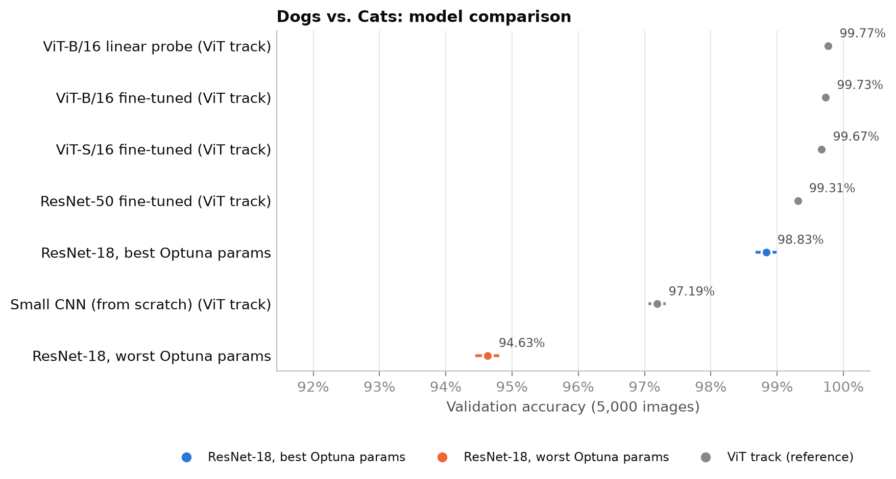
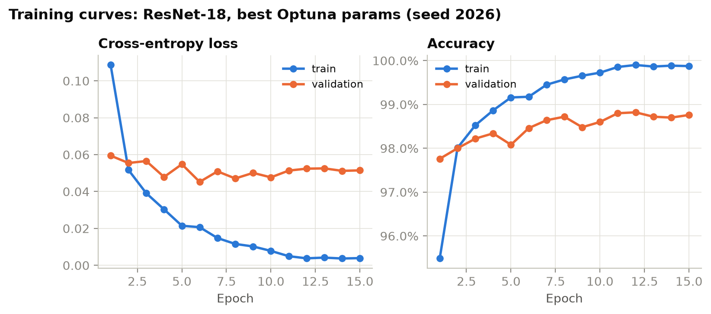
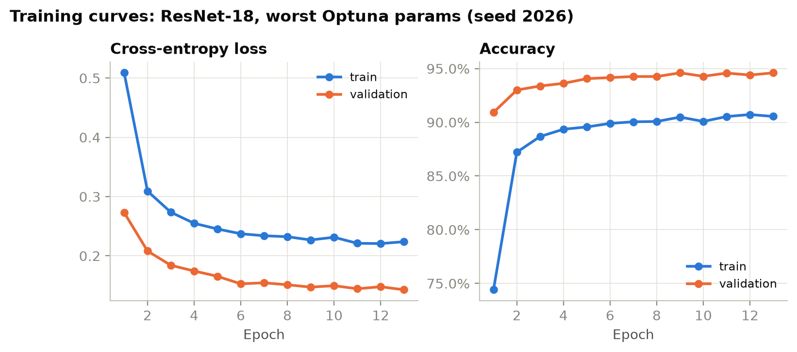
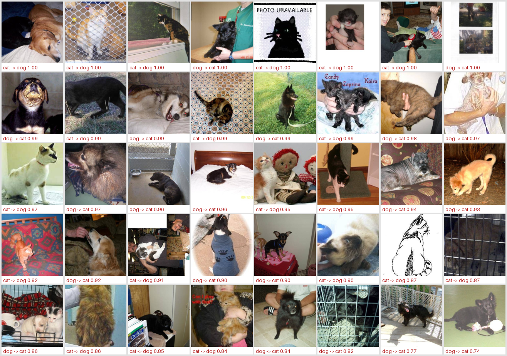
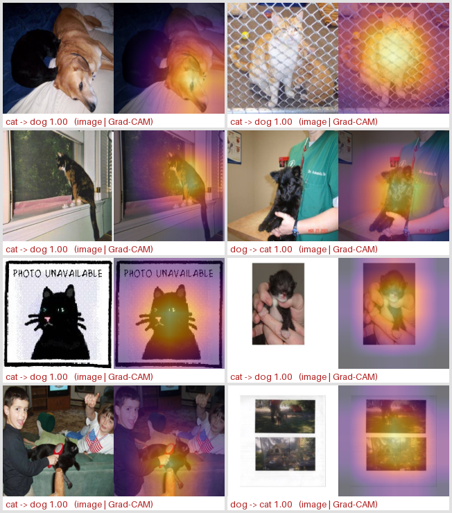
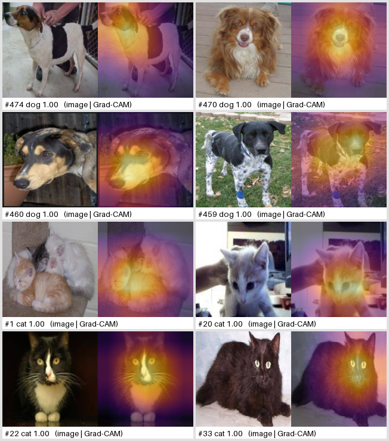
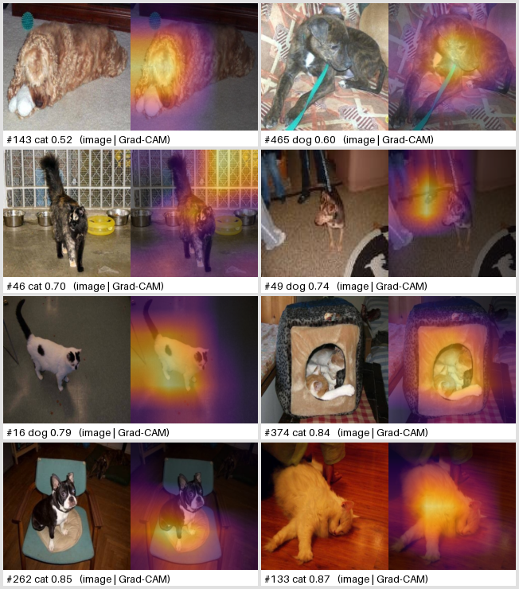
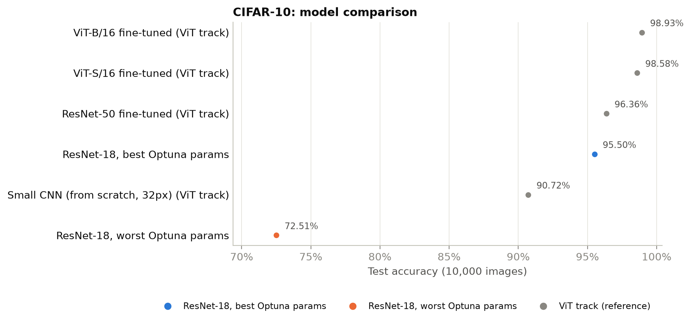
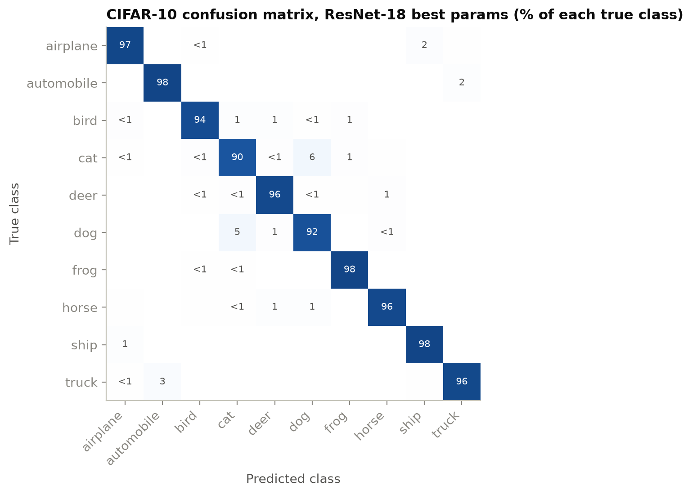
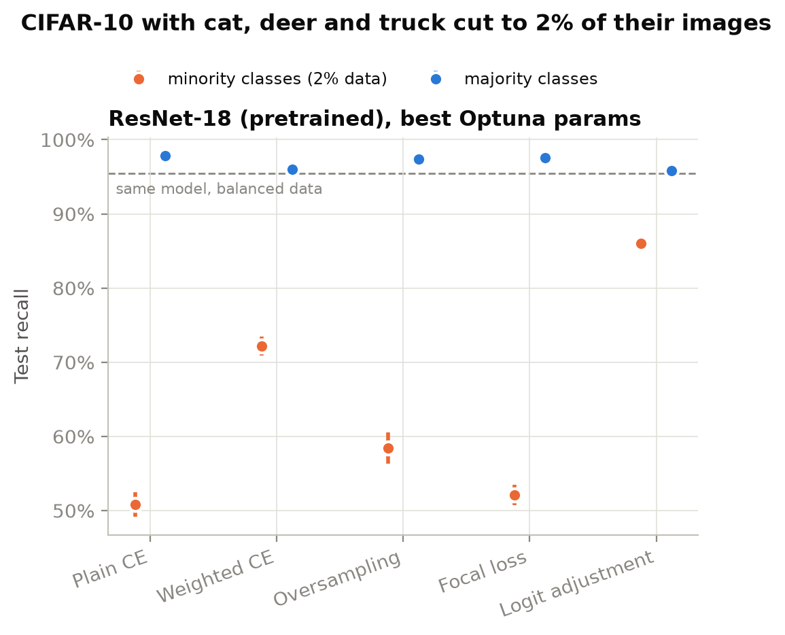

# ResNet-18 track: complete results

IE4483 mini project, ResNet track (Ong Dun Yan). Every number in this file is read from the run outputs in `src/resnet/outputs/runs/` (one folder per run with `metrics.json` and `history.csv`) and the tables generated by `src/resnet/scripts/summarize.py` / `analyze.py` in this folder. The ViT track (`results/vit/`, Arjun) is quoted for comparison where it ran a matching experiment.

- Runs: 6 Dogs vs. Cats + 21 CIFAR-10 = 27 training runs, seeds 2026 / 2027 / 2028 for every configuration.
- Mean ± std is over the 3 seeds (sample standard deviation, ddof = 1). All accuracies are in %.
- Two baselines, both taken from the 65-trial Optuna search: **best** = trial #20, **worst** = trial #0 (lowest completed trial).

## Contents

1. [Headline results](#1-headline-results)
2. [Experimental setup](#2-experimental-setup)
3. [Hyper-parameter search (Optuna)](#3-hyper-parameter-search-optuna)
4. [Dogs vs. Cats](#4-dogs-vs-cats)
5. [Dogs vs. Cats: error analysis and test predictions](#5-dogs-vs-cats-error-analysis-and-test-predictions)
6. [CIFAR-10 (balanced)](#6-cifar-10-balanced)
7. [CIFAR-10 with class imbalance](#7-cifar-10-with-class-imbalance)
8. [Comparison with the ViT track](#8-comparison-with-the-vit-track)
9. [Compute and run times](#9-compute-and-run-times)
10. [Reproduction](#10-reproduction)
11. [File index](#11-file-index)

## 1. Headline results

| Experiment | Metric | ResNet-18, best params | ResNet-18, worst params | Gap (best − worst) |
|---|---|---|---|---|
| Dogs vs. Cats (5,000 val images) | val accuracy | 98.83 ± 0.16 | 94.63 ± 0.18 | 4.21 pp |
| CIFAR-10 balanced (10,000 test images) | test accuracy | 95.50 ± 0.06 | 72.51 ± 0.15 | 22.99 pp |

Imbalanced CIFAR-10 (cat, deer, truck kept at 2 % of their training images), best params:

| Method | Test acc | Macro-F1 | Minority recall | Majority recall |
|---|---|---|---|---|
| Plain CE | 83.72 ± 0.55 | 82.04 ± 0.73 | 50.80 ± 1.65 | 97.82 ± 0.09 |
| Class-weighted CE | 88.86 ± 0.42 | 88.46 ± 0.48 | 72.16 ± 1.30 | 96.01 ± 0.04 |
| Oversampling | 85.70 ± 0.65 | 84.43 ± 0.81 | 58.44 ± 2.08 | 97.38 ± 0.07 |
| Focal loss (γ = 2) | 83.95 ± 0.43 | 82.41 ± 0.52 | 52.11 ± 1.37 | 97.59 ± 0.17 |
| Logit adjustment (τ = 1) | 92.89 ± 0.08 | 92.84 ± 0.08 | 86.04 ± 0.37 | 95.82 ± 0.13 |

Main findings:

1. The best Optuna parameters reproduce: 98.83 % mean validation accuracy over 3 new seeds vs. 98.86 % for trial #20 in the search.
2. The worst parameters (frozen backbone, SGD, tiny learning rate) cost 4.21 pp on Dogs vs. Cats but 22.99 pp on CIFAR-10: a 2-class problem is nearly linearly separable on ImageNet features, 10 classes at 32 px are not.
3. On imbalanced CIFAR-10, logit adjustment is clearly best (minority recall 86.04 ± 0.37 % vs. 50.80 ± 1.65 % for plain CE); class-weighted CE is second; focal loss does not help.
4. ResNet-18 trails the ViT track's ResNet-50 by about 0.5 pp (Dogs vs. Cats) and 0.9 pp (CIFAR-10), and ViT-B/16 by about 0.9 pp and 3.4 pp (section 8).

## 2. Experimental setup

### 2.1 Data

| Dataset | Train | Validation | Test | Notes |
|---|---|---|---|---|
| Dogs vs. Cats | 20,000 (10,000 cat / 10,000 dog) | 5,000 (2,500 / 2,500) | 500 unlabelled | `data/dogs_cats/datasets`, labels cat = 0, dog = 1 |
| CIFAR-10 balanced | 45,000 (4,500 per class) | 5,000 (500 per class) | 10,000 (official test set) | val = stratified split of the official training set, fixed seed 0 (same split as the ViT track) |
| CIFAR-10 imbalanced | 31,770 (4,500 per majority class, 90 each for cat / deer / truck) | 5,000 balanced | 10,000 balanced | step imbalance, minority fraction 2 %, classes 3, 4, 9 |

### 2.2 Model and preprocessing

- **Model:** torchvision ResNet-18, ImageNet-1k weights (`ResNet18_Weights.DEFAULT`), classifier replaced by `Dropout(p) → Linear(512, n_classes)`. 11.18 M parameters.
- **Dogs vs. Cats input:** 160 × 160. Training augmentation: RandomResizedCrop(160, scale 0.75–1), horizontal flip, rotation ±12°, ColorJitter(0.2, 0.2, 0.2, 0.05). Evaluation: resize to 160 × 160. ImageNet mean/std normalisation.
- **CIFAR-10 input:** augmented at 32 × 32 (reflect-pad 4 + random crop, horizontal flip), normalised, then bilinearly upsampled to 160 × 160 on the GPU inside the model.
- **Test-time:** Dogs vs. Cats test predictions average the original and horizontally flipped image (flip TTA). CIFAR-10 uses no TTA.

### 2.3 The two baselines

| Hyper-parameter | best (Optuna trial #20) | worst (Optuna trial #0) |
|---|---|---|
| Optuna val accuracy | 98.86 % | 95.36 % |
| Optimizer | NAdam | SGD, Nesterov momentum 0.9 |
| Learning rate | 8.181e-05 | 1.660e-05 |
| Weight decay | 1.845e-06 | 8.263e-05 |
| Batch size | 64 | 16 |
| Dropout before the classifier | 0.311 | 0.279 |
| Trainable layers | whole network (11.18 M params) | classifier only (1,026 params DvC / 5,130 CIFAR) |

Shared: cosine LR schedule over the epoch budget (stepped per epoch), cross-entropy loss (no label smoothing), mixed precision (fp16 autocast + GradScaler), no gradient clipping.

### 2.4 Training protocol

|  | Dogs vs. Cats | CIFAR-10 |
|---|---|---|
| Epoch budget | 15 | 5 |
| Early stopping | patience 4 on val accuracy | none |
| Model reported | best-val-accuracy epoch | final epoch (test set never used for selection) |
| Metric | validation set (5,000) | official test set (10,000) |
| Seeds | 2026, 2027, 2028 | 2026, 2027, 2028 |

Differences from the Optuna search: cuDNN is enabled (the search ran with cuDNN disabled; a 1-epoch A/B test gave identical accuracy and was ~25 % faster), seeds are 2026–2028 instead of 2026 + trial number, and the validation batch size is 2× the training batch size (no effect on accuracy in eval mode). `num_workers` stays 0: worker processes crashed the CUDA driver on this laptop.

### 2.5 Hardware and software

NVIDIA GeForce RTX 4060 Laptop GPU (8 GB), Windows 11, Python 3.13, PyTorch 2.11.0+cu128, torchvision 0.26.0, cuDNN 9.19.

### 2.6 Configuration files (verbatim)

`src/resnet/configs/dogs_cats_best.yaml`

```yaml
# Best Optuna trial (#20, 98.86% val acc); full search in results/resnet/optuna_search.md
task: dogs_cats
name: best
model: resnet18
pretrained: true
num_classes: 2
image_size: 160
batch_size: 64
epochs: 15
patience: 4
optimizer: nadam
learning_rate: 8.181391538335567e-05
weight_decay: 1.8448923279285054e-06
momentum: 0.9
dropout: 0.31103473606481874
fine_tuning: full
scheduler: cosine
warmup_epochs: 2
label_smoothing: 0.0
seed: 2026
num_workers: 0  # >0 crashes the CUDA driver on this laptop
amp: true
cudnn_safe: false  # cuDNN on: same accuracy as the Optuna setting (off), ~25% faster
```

`src/resnet/configs/dogs_cats_worst.yaml`

```yaml
# Worst completed Optuna trial (#0, 95.36% val acc); full search in results/resnet/optuna_search.md
task: dogs_cats
name: worst
model: resnet18
pretrained: true
num_classes: 2
image_size: 160
batch_size: 16
epochs: 15
patience: 4
optimizer: sgd_nesterov
learning_rate: 1.6604035607215475e-05
weight_decay: 8.263412613109886e-05
momentum: 0.9
dropout: 0.27912505743292915
fine_tuning: classifier_only
scheduler: cosine
warmup_epochs: 2
label_smoothing: 0.0
seed: 2026
num_workers: 0  # >0 crashes the CUDA driver on this laptop
amp: true
cudnn_safe: false  # cuDNN on: same accuracy as the Optuna setting (off), ~25% faster
```

`src/resnet/configs/cifar10_best.yaml`

```yaml
# Best Optuna trial (#20, 98.86% val acc); full search in results/resnet/optuna_search.md
# CIFAR-10: 5 epochs (as in the ViT track), final epoch evaluated on test, no early stopping
task: cifar10
name: best
model: resnet18
pretrained: true
num_classes: 10
image_size: 160
batch_size: 64
epochs: 5
patience: 5
optimizer: nadam
learning_rate: 8.181391538335567e-05
weight_decay: 1.8448923279285054e-06
momentum: 0.9
dropout: 0.31103473606481874
fine_tuning: full
scheduler: cosine
warmup_epochs: 2
label_smoothing: 0.0
seed: 2026
num_workers: 0  # >0 crashes the CUDA driver on this laptop
amp: true
cudnn_safe: false  # cuDNN on: same accuracy as the Optuna setting (off), ~25% faster
```

`src/resnet/configs/cifar10_worst.yaml`

```yaml
# Worst completed Optuna trial (#0, 95.36% val acc); full search in results/resnet/optuna_search.md
# CIFAR-10: 5 epochs (as in the ViT track), final epoch evaluated on test, no early stopping
task: cifar10
name: worst
model: resnet18
pretrained: true
num_classes: 10
image_size: 160
batch_size: 16
epochs: 5
patience: 5
optimizer: sgd_nesterov
learning_rate: 1.6604035607215475e-05
weight_decay: 8.263412613109886e-05
momentum: 0.9
dropout: 0.27912505743292915
fine_tuning: classifier_only
scheduler: cosine
warmup_epochs: 2
label_smoothing: 0.0
seed: 2026
num_workers: 0  # >0 crashes the CUDA driver on this laptop
amp: true
cudnn_safe: false  # cuDNN on: same accuracy as the Optuna setting (off), ~25% faster
```

## 3. Hyper-parameter search (Optuna)

Reproduced from [optuna_search.md](optuna_search.md) (exported from `src/resnet/outputs/optuna/dogs_cats.db`).

Exported from `src/resnet/outputs/optuna/dogs_cats.db` (study `dogs_cats_resnet`, direction `maximize`, objective = best validation accuracy over the run).

### Setup

- Model: ResNet-18, ImageNet-pretrained, 160 px input, 2 classes
- Budget per trial: up to 15 epochs, early stopping patience 4, cosine LR schedule, AMP
- Sampler: TPE (seed 2026); pruner: MedianPruner (n_startup_trials=8, n_warmup_steps=3)
- Per-trial seed: 2026 + trial number
- Trials: 65 total, 37 complete, 1 fail, 25 pruned, 2 running
- Run window: 2026-09-27 03:29 to 2026-09-29 04:11

RUNNING trials were interrupted and never finished; their partial curves are listed for completeness.

### Search space

| parameter | distribution | range / choices |
|---|---|---|
| optimizer | categorical | adamw, nadam, sgd_nesterov |
| learning_rate | log-uniform | 1e-05 to 0.003 |
| weight_decay | log-uniform | 1e-06 to 0.01 |
| batch_size | categorical | 16, 32, 64 |
| dropout | uniform | 0.0 to 0.5 |
| fine_tuning | categorical | classifier_only, layer4_plus_classifier, full |

### Best trial

Trial 20: validation accuracy **98.86%** (tied with trial 35).

| parameter | value |
|---|---|
| optimizer | nadam |
| learning_rate | 8.181391538335567e-05 |
| weight_decay | 1.8448923279285054e-06 |
| batch_size | 64 |
| dropout | 0.31103473606481874 |
| fine_tuning | full |

Per-epoch validation accuracy (%) of the tied best trials:

| trial | 1 | 2 | 3 | 4 | 5 | 6 | 7 | 8 | 9 | 10 | 11 | 12 | 13 | 14 | 15 |
|---|---|---|---|---|---|---|---|---|---|---|---|---|---|---|---|
| 20 | 98.10 | 98.22 | 98.26 | 98.56 | 98.34 | 98.36 | 98.60 | 98.66 | 98.54 | 98.74 | 98.86 | 98.80 | 98.78 | 98.72 | 98.82 |
| 35 | 98.10 | 97.88 | 98.34 | 98.62 | 98.52 | 98.62 | 98.78 | 98.82 | 98.70 | 98.76 | 98.86 | 98.74 | 98.80 | 98.84 | 98.80 |

Trial 35 parameters: optimizer=nadam, learning_rate=5.78e-05, weight_decay=4.91e-05, batch_size=64, dropout=0.430, fine_tuning=full.

### Top 10 completed trials

| rank | trial | val_acc_% | epochs | minutes | optimizer | learning_rate | weight_decay | batch_size | dropout | fine_tuning |
|---|---|---|---|---|---|---|---|---|---|---|
| 1 | 20 | 98.86 | 15 | 68 | nadam | 8.18e-05 | 1.84e-06 | 64 | 0.311 | full |
| 2 | 35 | 98.86 | 15 | 73 | nadam | 5.78e-05 | 4.91e-05 | 64 | 0.430 | full |
| 3 | 15 | 98.84 | 15 | 73 | nadam | 2.31e-05 | 5.51e-06 | 32 | 0.115 | full |
| 4 | 23 | 98.84 | 15 | 69 | nadam | 8.11e-05 | 2.17e-06 | 64 | 0.333 | full |
| 5 | 34 | 98.82 | 12 | 55 | nadam | 3.94e-05 | 1.40e-06 | 64 | 0.419 | full |
| 6 | 42 | 98.82 | 15 | 72 | nadam | 6.00e-05 | 1.15e-05 | 64 | 0.251 | full |
| 7 | 37 | 98.78 | 15 | 78 | nadam | 1.24e-05 | 2.74e-06 | 32 | 0.190 | full |
| 8 | 51 | 98.78 | 15 | 68 | nadam | 7.17e-05 | 2.04e-05 | 64 | 0.468 | full |
| 9 | 58 | 98.78 | 12 | 54 | nadam | 4.50e-05 | 3.37e-06 | 64 | 0.295 | full |
| 10 | 33 | 98.76 | 10 | 46 | adamw | 4.59e-05 | 1.87e-06 | 64 | 0.313 | full |

### Best accuracy by categorical choice (completed trials)

| optimizer | n | best_% | mean_% |
|---|---|---|---|
| adamw | 8 | 98.76 | 98.36 |
| nadam | 27 | 98.86 | 98.69 |
| sgd_nesterov | 2 | 95.40 | 95.38 |

| fine_tuning | n | best_% | mean_% |
|---|---|---|---|
| classifier_only | 2 | 95.40 | 95.38 |
| layer4_plus_classifier | 1 | 98.22 | 98.22 |
| full | 34 | 98.86 | 98.63 |

| batch_size | n | best_% | mean_% |
|---|---|---|---|
| 16 | 3 | 98.14 | 96.30 |
| 32 | 11 | 98.84 | 98.60 |
| 64 | 23 | 98.86 | 98.65 |

### All trials

`val_acc_%` is the objective for completed trials; `best_seen_%` is the highest per-epoch validation accuracy reported before the trial stopped.

| trial | state | val_acc_% | best_seen_% | epochs | minutes | optimizer | learning_rate | weight_decay | batch_size | dropout | fine_tuning |
|---|---|---|---|---|---|---|---|---|---|---|---|
| 0 | COMPLETE | 95.36 | 95.36 | 15 | 138 | sgd_nesterov | 1.66e-05 | 8.26e-05 | 16 | 0.279 | classifier_only |
| 1 | RUNNING |  | 98.54 | 5 |  | nadam | 1.27e-04 | 1.77e-04 | 64 | 0.015 | full |
| 2 | RUNNING |  |  | 0 |  | sgd_nesterov | 1.66e-05 | 8.26e-05 | 16 | 0.279 | classifier_only |
| 3 | COMPLETE | 95.40 | 95.40 | 13 | 54 | sgd_nesterov | 1.66e-05 | 8.26e-05 | 16 | 0.279 | classifier_only |
| 4 | COMPLETE | 98.62 | 98.62 | 8 | 35 | nadam | 1.27e-04 | 1.77e-04 | 64 | 0.015 | full |
| 5 | COMPLETE | 98.68 | 98.68 | 15 | 69 | nadam | 1.31e-05 | 7.62e-05 | 32 | 0.260 | full |
| 6 | COMPLETE | 98.14 | 98.14 | 8 | 40 | adamw | 1.31e-04 | 5.75e-03 | 16 | 0.105 | full |
| 7 | COMPLETE | 97.64 | 97.64 | 15 | 64 | adamw | 2.61e-03 | 1.02e-06 | 64 | 0.498 | full |
| 8 | COMPLETE | 98.22 | 98.22 | 15 | 53 | adamw | 1.74e-05 | 9.76e-03 | 64 | 0.084 | layer4_plus_classifier |
| 9 | COMPLETE | 98.22 | 98.22 | 15 | 69 | adamw | 5.61e-04 | 2.68e-06 | 32 | 0.140 | full |
| 10 | PRUNED | 96.68 | 96.68 | 4 | 17 | adamw | 1.08e-03 | 2.57e-03 | 64 | 0.358 | full |
| 11 | COMPLETE | 98.66 | 98.66 | 13 | 60 | adamw | 3.18e-05 | 5.35e-03 | 32 | 0.162 | full |
| 12 | COMPLETE | 98.40 | 98.40 | 5 | 22 | nadam | 3.14e-05 | 2.04e-03 | 32 | 0.460 | full |
| 13 | COMPLETE | 98.60 | 98.60 | 10 | 46 | nadam | 1.01e-05 | 1.90e-06 | 32 | 0.263 | full |
| 14 | COMPLETE | 98.56 | 98.56 | 9 | 44 | adamw | 5.09e-05 | 3.23e-03 | 32 | 0.251 | full |
| 15 | COMPLETE | 98.84 | 98.84 | 15 | 73 | nadam | 2.31e-05 | 5.51e-06 | 32 | 0.115 | full |
| 16 | COMPLETE | 98.56 | 98.56 | 6 | 30 | nadam | 3.53e-05 | 5.20e-05 | 32 | 0.175 | full |
| 17 | COMPLETE | 98.62 | 98.62 | 15 | 74 | nadam | 1.43e-05 | 4.64e-06 | 32 | 0.002 | full |
| 18 | COMPLETE | 98.56 | 98.56 | 13 | 59 | nadam | 1.32e-05 | 2.47e-05 | 64 | 0.157 | full |
| 19 | PRUNED | 97.88 | 97.94 | 4 | 21 | nadam | 1.07e-04 | 1.60e-06 | 16 | 0.148 | full |
| 20 | COMPLETE | 98.86 | 98.86 | 15 | 68 | nadam | 8.18e-05 | 1.84e-06 | 64 | 0.311 | full |
| 21 | COMPLETE | 98.74 | 98.74 | 10 | 46 | nadam | 3.17e-05 | 1.59e-06 | 64 | 0.248 | full |
| 22 | COMPLETE | 98.50 | 98.50 | 8 | 38 | nadam | 1.60e-05 | 1.31e-05 | 64 | 0.265 | full |
| 23 | COMPLETE | 98.84 | 98.84 | 15 | 69 | nadam | 8.11e-05 | 2.17e-06 | 64 | 0.333 | full |
| 24 | PRUNED | 97.96 | 97.96 | 4 | 18 | nadam | 2.06e-04 | 1.43e-06 | 64 | 0.332 | full |
| 25 | PRUNED | 97.90 | 97.90 | 4 | 15 | nadam | 1.01e-04 | 9.90e-06 | 64 | 0.332 | layer4_plus_classifier |
| 26 | COMPLETE | 98.64 | 98.64 | 14 | 64 | nadam | 2.38e-05 | 4.15e-06 | 64 | 0.456 | full |
| 27 | PRUNED | 98.12 | 98.12 | 4 | 18 | sgd_nesterov | 3.09e-04 | 6.25e-06 | 64 | 0.247 | full |
| 28 | COMPLETE | 98.64 | 98.64 | 9 | 44 | adamw | 2.65e-05 | 2.44e-06 | 32 | 0.097 | full |
| 29 | COMPLETE | 98.74 | 98.74 | 11 | 51 | nadam | 3.53e-05 | 3.54e-06 | 64 | 0.044 | full |
| 30 | PRUNED | 97.46 | 97.46 | 4 | 20 | sgd_nesterov | 4.87e-05 | 4.31e-06 | 32 | 0.238 | full |
| 31 | PRUNED | 98.38 | 98.38 | 4 | 18 | nadam | 8.05e-05 | 6.12e-06 | 64 | 0.390 | full |
| 32 | PRUNED | 97.26 | 97.34 | 4 | 21 | nadam | 1.55e-04 | 1.76e-05 | 16 | 0.189 | full |
| 33 | COMPLETE | 98.76 | 98.76 | 10 | 46 | adamw | 4.59e-05 | 1.87e-06 | 64 | 0.313 | full |
| 34 | COMPLETE | 98.82 | 98.82 | 12 | 55 | nadam | 3.94e-05 | 1.40e-06 | 64 | 0.419 | full |
| 35 | COMPLETE | 98.86 | 98.86 | 15 | 73 | nadam | 5.78e-05 | 4.91e-05 | 64 | 0.430 | full |
| 36 | PRUNED | 98.38 | 98.38 | 4 | 20 | nadam | 1.18e-04 | 1.45e-06 | 64 | 0.419 | full |
| 37 | COMPLETE | 98.78 | 98.78 | 15 | 78 | nadam | 1.24e-05 | 2.74e-06 | 32 | 0.190 | full |
| 38 | PRUNED | 98.44 | 98.44 | 4 | 21 | nadam | 7.15e-05 | 8.02e-06 | 32 | 0.065 | full |
| 39 | PRUNED | 98.40 | 98.40 | 4 | 19 | nadam | 8.30e-05 | 1.83e-06 | 64 | 0.240 | full |
| 40 | PRUNED | 97.84 | 97.84 | 4 | 19 | nadam | 2.75e-04 | 5.66e-06 | 64 | 0.423 | full |
| 41 | COMPLETE | 98.74 | 98.74 | 9 | 43 | nadam | 3.80e-05 | 1.79e-05 | 64 | 0.322 | full |
| 42 | COMPLETE | 98.82 | 98.82 | 15 | 72 | nadam | 6.00e-05 | 1.15e-05 | 64 | 0.251 | full |
| 43 | PRUNED | 98.66 | 98.66 | 14 | 64 | nadam | 4.55e-05 | 1.03e-05 | 64 | 0.463 | full |
| 44 | PRUNED | 98.16 | 98.24 | 4 | 19 | nadam | 6.49e-05 | 2.13e-06 | 32 | 0.389 | full |
| 45 | PRUNED | 98.38 | 98.42 | 4 | 18 | nadam | 3.90e-05 | 1.17e-06 | 64 | 0.474 | full |
| 46 | PRUNED | 98.24 | 98.24 | 4 | 18 | nadam | 1.85e-04 | 2.60e-06 | 64 | 0.269 | full |
| 47 | PRUNED | 97.34 | 97.34 | 4 | 18 | sgd_nesterov | 9.12e-05 | 2.61e-06 | 64 | 0.370 | full |
| 48 | COMPLETE | 98.56 | 98.56 | 8 | 36 | nadam | 7.59e-05 | 1.28e-06 | 64 | 0.175 | full |
| 49 | COMPLETE | 98.68 | 98.68 | 9 | 41 | nadam | 7.34e-05 | 2.53e-05 | 64 | 0.341 | full |
| 50 | COMPLETE | 98.70 | 98.70 | 11 | 50 | nadam | 3.42e-05 | 1.02e-06 | 64 | 0.178 | full |
| 51 | COMPLETE | 98.78 | 98.78 | 15 | 68 | nadam | 7.17e-05 | 2.04e-05 | 64 | 0.468 | full |
| 52 | COMPLETE | 98.70 | 98.70 | 12 | 54 | nadam | 2.18e-05 | 1.30e-06 | 64 | 0.383 | full |
| 53 | COMPLETE | 98.68 | 98.68 | 8 | 37 | nadam | 3.89e-05 | 3.63e-05 | 64 | 0.369 | full |
| 54 | PRUNED | 98.20 | 98.28 | 4 | 20 | nadam | 6.01e-05 | 2.71e-06 | 16 | 0.344 | full |
| 55 | COMPLETE | 98.60 | 98.60 | 8 | 36 | nadam | 4.29e-05 | 1.97e-05 | 64 | 0.424 | full |
| 56 | PRUNED | 98.40 | 98.40 | 4 | 18 | nadam | 9.34e-05 | 4.96e-05 | 64 | 0.423 | full |
| 57 | PRUNED | 98.38 | 98.44 | 4 | 18 | nadam | 2.94e-05 | 1.14e-06 | 64 | 0.312 | full |
| 58 | COMPLETE | 98.78 | 98.78 | 12 | 54 | nadam | 4.50e-05 | 3.37e-06 | 64 | 0.295 | full |
| 59 | PRUNED | 98.08 | 98.08 | 4 | 18 | nadam | 2.07e-04 | 2.02e-06 | 64 | 0.408 | full |
| 60 | PRUNED | 98.18 | 98.18 | 4 | 18 | nadam | 1.48e-04 | 1.81e-05 | 64 | 0.420 | full |
| 61 | PRUNED | 98.32 | 98.48 | 4 | 18 | nadam | 8.80e-05 | 2.56e-06 | 64 | 0.292 | full |
| 62 | PRUNED | 98.44 | 98.44 | 4 | 18 | nadam | 5.10e-05 | 4.58e-05 | 64 | 0.436 | full |
| 63 | PRUNED | 98.36 | 98.42 | 4 | 19 | nadam | 1.17e-05 | 3.42e-06 | 32 | 0.203 | full |
| 64 | FAIL |  | 98.68 | 8 | 39 | nadam | 1.40e-05 | 8.08e-06 | 32 | 0.220 | full |

## 4. Dogs vs. Cats

### 4.1 Summary per baseline (mean ± std over 3 seeds, validation set, best epoch)

| Baseline | Accuracy | Balanced acc. | Precision (dog) | Recall (dog) | F1 (dog) | Val loss | Final-epoch acc. | Best epoch | Epochs run | Minutes / run |
|---|---|---|---|---|---|---|---|---|---|---|
| best | 98.83 ± 0.16 | 98.83 ± 0.16 | 98.84 ± 0.11 | 98.83 ± 0.24 | 98.83 ± 0.16 | 0.0469 | 98.61 ± 0.32 | 9.3 | 13.0 | 25.7 |
| worst | 94.63 ± 0.18 | 94.63 ± 0.18 | 95.21 ± 1.28 | 94.01 ± 1.64 | 94.59 ± 0.25 | 0.1497 | 94.45 ± 0.16 | 9.3 | 13.0 | 27.1 |

Precision / recall / F1 treat *dog* (label 1) as the positive class. 'Final-epoch acc.' is the accuracy of the last epoch trained (after early stopping), for comparison with the selected epoch.

### 4.2 Every run

| Run | Seed | Val acc | Bal. acc | Precision | Recall | F1 | Val loss | Best epoch | Epochs run | Final acc | Final loss | Val errors | Test → dog | Test → cat | Minutes |
|---|---|---|---|---|---|---|---|---|---|---|---|---|---|---|---|
| resnet18-best-s2026 | 2026 | 98.82 | 98.82 | 98.76 | 98.88 | 98.82 | 0.0524 | 12 | 15 | 98.76 | 0.0515 | 59 | 264 | 236 | 31.6 |
| resnet18-best-s2027 | 2027 | 99.00 | 99.00 | 98.96 | 99.04 | 99.00 | 0.0419 | 10 | 14 | 98.82 | 0.0425 | 50 | 260 | 240 | 26.8 |
| resnet18-best-s2028 | 2028 | 98.68 | 98.68 | 98.80 | 98.56 | 98.68 | 0.0464 | 6 | 10 | 98.24 | 0.0600 | 66 | 259 | 241 | 18.6 |
| resnet18-worst-s2026 | 2026 | 94.60 | 94.60 | 94.18 | 95.08 | 94.63 | 0.1472 | 9 | 13 | 94.60 | 0.1427 | 270 | 256 | 244 | 26.8 |
| resnet18-worst-s2027 | 2027 | 94.46 | 94.46 | 96.64 | 92.12 | 94.33 | 0.1561 | 7 | 11 | 94.46 | 0.1526 | 277 | 244 | 256 | 22.5 |
| resnet18-worst-s2028 | 2028 | 94.82 | 94.82 | 94.80 | 94.84 | 94.82 | 0.1458 | 12 | 15 | 94.28 | 0.1506 | 259 | 257 | 243 | 32.0 |

### 4.3 Confusion matrices (validation, best epoch; rows = true class, columns = predicted)

| Run | cat → cat | cat → dog | dog → cat | dog → dog | Cat recall | Dog recall |
|---|---|---|---|---|---|---|
| resnet18-best-s2026 | 2469 | 31 | 28 | 2472 | 98.76 | 98.88 |
| resnet18-best-s2027 | 2474 | 26 | 24 | 2476 | 98.96 | 99.04 |
| resnet18-best-s2028 | 2470 | 30 | 36 | 2464 | 98.80 | 98.56 |
| resnet18-worst-s2026 | 2353 | 147 | 123 | 2377 | 94.12 | 95.08 |
| resnet18-worst-s2027 | 2420 | 80 | 197 | 2303 | 96.80 | 92.12 |
| resnet18-worst-s2028 | 2370 | 130 | 129 | 2371 | 94.80 | 94.84 |

Mean confusion matrix, **best** (counts, mean over seeds):

| true \ predicted | cat | dog |
|---|---|---|
| cat | 2471.0 | 29.0 |
| dog | 29.3 | 2470.7 |

Mean confusion matrix, **worst** (counts, mean over seeds):

| true \ predicted | cat | dog |
|---|---|---|
| cat | 2381.0 | 119.0 |
| dog | 149.7 | 2350.3 |

### 4.4 Per-epoch training history (every run)

`lr` is the learning rate used during that epoch (cosine schedule). Train metrics are averaged over the epoch with augmentation and dropout active; validation metrics use the evaluation transform. ★ marks the epoch kept.

**resnet18-best-s2026** (best epoch 12, stopped after 15 of 15)

| Epoch | LR | Train loss | Train acc | Val loss | Val acc | Val F1 | Seconds |
|---|---|---|---|---|---|---|---|
| 1 | 8.18e-05 | 0.1086 | 95.48 | 0.0594 | 97.76 | 97.76 | 147 |
| 2 | 8.09e-05 | 0.0517 | 98.01 | 0.0555 | 98.00 | 98.00 | 125 |
| 3 | 7.83e-05 | 0.0391 | 98.52 | 0.0565 | 98.22 | 98.21 | 126 |
| 4 | 7.4e-05 | 0.0303 | 98.87 | 0.0479 | 98.34 | 98.34 | 124 |
| 5 | 6.83e-05 | 0.0215 | 99.16 | 0.0548 | 98.08 | 98.08 | 125 |
| 6 | 6.14e-05 | 0.0207 | 99.17 | 0.0452 | 98.46 | 98.46 | 125 |
| 7 | 5.35e-05 | 0.0148 | 99.45 | 0.0509 | 98.64 | 98.64 | 124 |
| 8 | 4.52e-05 | 0.0116 | 99.57 | 0.0471 | 98.72 | 98.72 | 124 |
| 9 | 3.66e-05 | 0.0102 | 99.66 | 0.0501 | 98.48 | 98.48 | 125 |
| 10 | 2.83e-05 | 0.0078 | 99.72 | 0.0477 | 98.60 | 98.60 | 127 |
| 11 | 2.05e-05 | 0.0049 | 99.86 | 0.0513 | 98.80 | 98.80 | 125 |
| 12 ★ | 1.35e-05 | 0.0038 | 99.90 | 0.0524 | 98.82 | 98.82 | 124 |
| 13 | 7.81e-06 | 0.0042 | 99.87 | 0.0525 | 98.72 | 98.72 | 126 |
| 14 | 3.54e-06 | 0.0037 | 99.89 | 0.0512 | 98.70 | 98.70 | 124 |
| 15 | 8.94e-07 | 0.0039 | 99.88 | 0.0515 | 98.76 | 98.76 | 126 |

**resnet18-best-s2027** (best epoch 10, stopped after 14 of 15)

| Epoch | LR | Train loss | Train acc | Val loss | Val acc | Val F1 | Seconds |
|---|---|---|---|---|---|---|---|
| 1 | 8.18e-05 | 0.1046 | 95.78 | 0.0560 | 97.96 | 97.96 | 123 |
| 2 | 8.09e-05 | 0.0519 | 98.07 | 0.0493 | 98.24 | 98.24 | 115 |
| 3 | 7.83e-05 | 0.0372 | 98.50 | 0.0507 | 98.18 | 98.19 | 115 |
| 4 | 7.4e-05 | 0.0276 | 98.92 | 0.0536 | 98.20 | 98.22 | 114 |
| 5 | 6.83e-05 | 0.0239 | 99.22 | 0.0432 | 98.52 | 98.52 | 112 |
| 6 | 6.14e-05 | 0.0185 | 99.36 | 0.0489 | 98.20 | 98.20 | 112 |
| 7 | 5.35e-05 | 0.0162 | 99.45 | 0.0536 | 98.28 | 98.27 | 111 |
| 8 | 4.52e-05 | 0.0101 | 99.63 | 0.0438 | 98.86 | 98.87 | 112 |
| 9 | 3.66e-05 | 0.0074 | 99.76 | 0.0474 | 98.68 | 98.68 | 134 |
| 10 ★ | 2.83e-05 | 0.0072 | 99.75 | 0.0419 | 99.00 | 99.00 | 114 |
| 11 | 2.05e-05 | 0.0055 | 99.81 | 0.0435 | 98.82 | 98.82 | 111 |
| 12 | 1.35e-05 | 0.0052 | 99.83 | 0.0467 | 98.76 | 98.76 | 111 |
| 13 | 7.81e-06 | 0.0044 | 99.89 | 0.0462 | 98.78 | 98.78 | 111 |
| 14 | 3.54e-06 | 0.0038 | 99.87 | 0.0425 | 98.82 | 98.82 | 111 |

**resnet18-best-s2028** (best epoch 6, stopped after 10 of 15)

| Epoch | LR | Train loss | Train acc | Val loss | Val acc | Val F1 | Seconds |
|---|---|---|---|---|---|---|---|
| 1 | 8.18e-05 | 0.1066 | 95.59 | 0.0563 | 97.84 | 97.82 | 111 |
| 2 | 8.09e-05 | 0.0505 | 97.96 | 0.0598 | 97.96 | 97.97 | 112 |
| 3 | 7.83e-05 | 0.0398 | 98.42 | 0.0503 | 98.24 | 98.24 | 111 |
| 4 | 7.4e-05 | 0.0274 | 98.94 | 0.0481 | 98.44 | 98.44 | 111 |
| 5 | 6.83e-05 | 0.0245 | 99.09 | 0.0580 | 97.94 | 97.92 | 111 |
| 6 ★ | 6.14e-05 | 0.0191 | 99.38 | 0.0464 | 98.68 | 98.68 | 111 |
| 7 | 5.35e-05 | 0.0158 | 99.47 | 0.0432 | 98.64 | 98.64 | 111 |
| 8 | 4.52e-05 | 0.0122 | 99.56 | 0.0519 | 98.40 | 98.41 | 111 |
| 9 | 3.66e-05 | 0.0077 | 99.71 | 0.0563 | 98.46 | 98.46 | 112 |
| 10 | 2.83e-05 | 0.0066 | 99.78 | 0.0600 | 98.24 | 98.25 | 112 |

**resnet18-worst-s2026** (best epoch 9, stopped after 13 of 15)

| Epoch | LR | Train loss | Train acc | Val loss | Val acc | Val F1 | Seconds |
|---|---|---|---|---|---|---|---|
| 1 | 1.66e-05 | 0.5088 | 74.41 | 0.2729 | 90.92 | 91.26 | 124 |
| 2 | 1.64e-05 | 0.3093 | 87.22 | 0.2082 | 93.00 | 93.04 | 124 |
| 3 | 1.59e-05 | 0.2736 | 88.67 | 0.1840 | 93.38 | 93.44 | 125 |
| 4 | 1.5e-05 | 0.2549 | 89.35 | 0.1744 | 93.62 | 93.72 | 125 |
| 5 | 1.39e-05 | 0.2453 | 89.56 | 0.1654 | 94.06 | 94.16 | 124 |
| 6 | 1.25e-05 | 0.2373 | 89.89 | 0.1528 | 94.16 | 94.15 | 124 |
| 7 | 1.09e-05 | 0.2339 | 90.05 | 0.1545 | 94.26 | 94.31 | 124 |
| 8 | 9.17e-06 | 0.2322 | 90.08 | 0.1512 | 94.26 | 94.34 | 124 |
| 9 ★ | 7.43e-06 | 0.2268 | 90.48 | 0.1472 | 94.60 | 94.63 | 123 |
| 10 | 5.74e-06 | 0.2314 | 90.08 | 0.1496 | 94.28 | 94.34 | 123 |
| 11 | 4.15e-06 | 0.2212 | 90.53 | 0.1444 | 94.58 | 94.61 | 123 |
| 12 | 2.75e-06 | 0.2207 | 90.72 | 0.1479 | 94.40 | 94.43 | 123 |
| 13 | 1.59e-06 | 0.2238 | 90.55 | 0.1427 | 94.60 | 94.60 | 124 |

**resnet18-worst-s2027** (best epoch 7, stopped after 11 of 15)

| Epoch | LR | Train loss | Train acc | Val loss | Val acc | Val F1 | Seconds |
|---|---|---|---|---|---|---|---|
| 1 | 1.66e-05 | 0.4646 | 77.66 | 0.2706 | 91.14 | 91.14 | 123 |
| 2 | 1.64e-05 | 0.3104 | 87.00 | 0.2144 | 92.56 | 92.70 | 123 |
| 3 | 1.59e-05 | 0.2744 | 88.56 | 0.1934 | 93.20 | 93.27 | 124 |
| 4 | 1.5e-05 | 0.2615 | 89.08 | 0.1732 | 94.10 | 94.06 | 124 |
| 5 | 1.39e-05 | 0.2482 | 89.42 | 0.1626 | 94.38 | 94.36 | 124 |
| 6 | 1.25e-05 | 0.2385 | 90.03 | 0.1608 | 94.34 | 94.37 | 123 |
| 7 ★ | 1.09e-05 | 0.2371 | 90.02 | 0.1561 | 94.46 | 94.33 | 123 |
| 8 | 9.17e-06 | 0.2324 | 90.36 | 0.1546 | 94.26 | 94.37 | 123 |
| 9 | 7.43e-06 | 0.2296 | 90.30 | 0.1538 | 94.46 | 94.49 | 121 |
| 10 | 5.74e-06 | 0.2264 | 90.39 | 0.1498 | 94.24 | 94.35 | 122 |
| 11 | 4.15e-06 | 0.2233 | 90.50 | 0.1526 | 94.46 | 94.53 | 121 |

**resnet18-worst-s2028** (best epoch 12, stopped after 15 of 15)

| Epoch | LR | Train loss | Train acc | Val loss | Val acc | Val F1 | Seconds |
|---|---|---|---|---|---|---|---|
| 1 | 1.66e-05 | 0.4907 | 75.58 | 0.2877 | 90.44 | 90.85 | 121 |
| 2 | 1.64e-05 | 0.3176 | 86.54 | 0.2206 | 92.66 | 92.86 | 122 |
| 3 | 1.59e-05 | 0.2780 | 88.00 | 0.1936 | 93.42 | 93.61 | 120 |
| 4 | 1.5e-05 | 0.2563 | 89.21 | 0.1750 | 94.08 | 94.16 | 121 |
| 5 | 1.39e-05 | 0.2501 | 89.08 | 0.1602 | 94.52 | 94.55 | 122 |
| 6 | 1.25e-05 | 0.2414 | 89.70 | 0.1667 | 93.74 | 93.91 | 121 |
| 7 | 1.09e-05 | 0.2351 | 90.22 | 0.1587 | 94.18 | 94.26 | 121 |
| 8 | 9.17e-06 | 0.2341 | 89.84 | 0.1539 | 94.48 | 94.53 | 121 |
| 9 | 7.43e-06 | 0.2312 | 90.09 | 0.1516 | 94.64 | 94.68 | 120 |
| 10 | 5.74e-06 | 0.2286 | 90.46 | 0.1502 | 94.56 | 94.54 | 120 |
| 11 | 4.15e-06 | 0.2249 | 90.70 | 0.1503 | 94.68 | 94.71 | 124 |
| 12 ★ | 2.75e-06 | 0.2305 | 90.12 | 0.1458 | 94.82 | 94.82 | 148 |
| 13 | 1.59e-06 | 0.2326 | 89.89 | 0.1629 | 93.62 | 93.83 | 148 |
| 14 | 7.18e-07 | 0.2321 | 90.25 | 0.1481 | 94.60 | 94.66 | 147 |
| 15 | 1.81e-07 | 0.2322 | 90.32 | 0.1506 | 94.28 | 94.38 | 145 |

### 4.5 Validation accuracy by epoch, all runs side by side

| Run | 1 | 2 | 3 | 4 | 5 | 6 | 7 | 8 | 9 | 10 | 11 | 12 | 13 | 14 | 15 |
|---|---|---|---|---|---|---|---|---|---|---|---|---|---|---|---|
| resnet18-best-s2026 | 97.76 | 98.00 | 98.22 | 98.34 | 98.08 | 98.46 | 98.64 | 98.72 | 98.48 | 98.60 | 98.80 | 98.82 | 98.72 | 98.70 | 98.76 |
| resnet18-best-s2027 | 97.96 | 98.24 | 98.18 | 98.20 | 98.52 | 98.20 | 98.28 | 98.86 | 98.68 | 99.00 | 98.82 | 98.76 | 98.78 | 98.82 |  |
| resnet18-best-s2028 | 97.84 | 97.96 | 98.24 | 98.44 | 97.94 | 98.68 | 98.64 | 98.40 | 98.46 | 98.24 |  |  |  |  |  |
| resnet18-worst-s2026 | 90.92 | 93.00 | 93.38 | 93.62 | 94.06 | 94.16 | 94.26 | 94.26 | 94.60 | 94.28 | 94.58 | 94.40 | 94.60 |  |  |
| resnet18-worst-s2027 | 91.14 | 92.56 | 93.20 | 94.10 | 94.38 | 94.34 | 94.46 | 94.26 | 94.46 | 94.24 | 94.46 |  |  |  |  |
| resnet18-worst-s2028 | 90.44 | 92.66 | 93.42 | 94.08 | 94.52 | 93.74 | 94.18 | 94.48 | 94.64 | 94.56 | 94.68 | 94.82 | 93.62 | 94.60 | 94.28 |

### 4.6 Figures







### 4.7 Reproducing the Optuna result

| Baseline | Optuna trial | Optuna val acc (1 seed, cuDNN off) | This study (3 seeds, cuDNN on) | Difference |
|---|---|---|---|---|
| best | #20 | 98.86 | 98.83 ± 0.16 | -0.03 pp |
| worst | #0 | 95.36 | 94.63 ± 0.18 | -0.73 pp |

Trial #0 reached its best accuracy at its last epoch (15); trial #3 of the search used identical parameters and reached 95.40 %. Here the worst-params runs stopped after 13 (seed 2026, best 94.60 % at epoch 9), 11 (seed 2027, best 94.46 % at epoch 7), 15 (seed 2028, best 94.82 % at epoch 12) epochs. The run that used all 15 epochs is not better than the early-stopped ones, so early stopping does not account for the ~0.7 pp gap; the search ran with cuDNN disabled and different seeds.

## 5. Dogs vs. Cats: error analysis and test predictions

Analysed run: `resnet18-best-s2027` (the best-params run with the highest validation accuracy, 99.00 %). Its `submission.csv` is copied to [analysis/submission.csv](analysis/submission.csv) (`id,label`, 1 = dog, 0 = cat, 500 rows).

### 5.1 Summary

| Quantity | Value |
|---|---|
| Validation images | 5000 |
| Validation errors | 50 (1.00 %) |
| cat predicted as dog | 26 |
| dog predicted as cat | 24 |
| Test images predicted dog | 260 |
| Test images predicted cat | 240 |
| Test images with confidence < 0.8 | 5: 16, 46, 49, 143, 465 |

### 5.2 Every validation error of the analysed run (most confident mistake first)

| # | Image | True label | P(dog) | Predicted | Confidence in the wrong class |
|---|---|---|---|---|---|
| 1 | `val/cat/cat.7920.jpg` | cat | 1.0000 | dog | 1.0000 |
| 2 | `val/cat/cat.9897.jpg` | cat | 1.0000 | dog | 1.0000 |
| 3 | `val/cat/cat.738.jpg` | cat | 0.9999 | dog | 0.9999 |
| 4 | `val/dog/dog.6528.jpg` | dog | 0.0001 | cat | 0.9999 |
| 5 | `val/cat/cat.11565.jpg` | cat | 0.9999 | dog | 0.9999 |
| 6 | `val/cat/cat.10151.jpg` | cat | 0.9998 | dog | 0.9998 |
| 7 | `val/cat/cat.2893.jpg` | cat | 0.9993 | dog | 0.9993 |
| 8 | `val/dog/dog.7076.jpg` | dog | 0.0011 | cat | 0.9989 |
| 9 | `val/dog/dog.11836.jpg` | dog | 0.0070 | cat | 0.9930 |
| 10 | `val/cat/cat.6734.jpg` | cat | 0.9922 | dog | 0.9922 |
| 11 | `val/dog/dog.5135.jpg` | dog | 0.0095 | cat | 0.9905 |
| 12 | `val/cat/cat.1772.jpg` | cat | 0.9905 | dog | 0.9905 |
| 13 | `val/dog/dog.9311.jpg` | dog | 0.0117 | cat | 0.9883 |
| 14 | `val/cat/cat.11544.jpg` | cat | 0.9858 | dog | 0.9858 |
| 15 | `val/dog/dog.10524.jpg` | dog | 0.0159 | cat | 0.9841 |
| 16 | `val/dog/dog.5336.jpg` | dog | 0.0289 | cat | 0.9711 |
| 17 | `val/cat/cat.10520.jpg` | cat | 0.9683 | dog | 0.9683 |
| 18 | `val/dog/dog.7595.jpg` | dog | 0.0336 | cat | 0.9664 |
| 19 | `val/dog/dog.1838.jpg` | dog | 0.0369 | cat | 0.9631 |
| 20 | `val/dog/dog.6199.jpg` | dog | 0.0412 | cat | 0.9588 |
| 21 | `val/cat/cat.10912.jpg` | cat | 0.9537 | dog | 0.9537 |
| 22 | `val/cat/cat.12365.jpg` | cat | 0.9521 | dog | 0.9521 |
| 23 | `val/dog/dog.9109.jpg` | dog | 0.0623 | cat | 0.9377 |
| 24 | `val/dog/dog.4808.jpg` | dog | 0.0665 | cat | 0.9335 |
| 25 | `val/cat/cat.9277.jpg` | cat | 0.9162 | dog | 0.9162 |
| 26 | `val/dog/dog.1269.jpg` | dog | 0.0843 | cat | 0.9157 |
| 27 | `val/cat/cat.8289.jpg` | cat | 0.9077 | dog | 0.9077 |
| 28 | `val/dog/dog.4198.jpg` | dog | 0.1023 | cat | 0.8977 |
| 29 | `val/dog/dog.1864.jpg` | dog | 0.1031 | cat | 0.8969 |
| 30 | `val/cat/cat.7323.jpg` | cat | 0.8967 | dog | 0.8967 |
| 31 | `val/cat/cat.2939.jpg` | cat | 0.8717 | dog | 0.8717 |
| 32 | `val/cat/cat.12390.jpg` | cat | 0.8696 | dog | 0.8696 |
| 33 | `val/dog/dog.8507.jpg` | dog | 0.1367 | cat | 0.8633 |
| 34 | `val/cat/cat.11149.jpg` | cat | 0.8609 | dog | 0.8609 |
| 35 | `val/cat/cat.2150.jpg` | cat | 0.8458 | dog | 0.8458 |
| 36 | `val/cat/cat.12131.jpg` | cat | 0.8424 | dog | 0.8424 |
| 37 | `val/dog/dog.6769.jpg` | dog | 0.1585 | cat | 0.8415 |
| 38 | `val/dog/dog.12353.jpg` | dog | 0.1785 | cat | 0.8215 |
| 39 | `val/dog/dog.4065.jpg` | dog | 0.2269 | cat | 0.7731 |
| 40 | `val/dog/dog.2819.jpg` | dog | 0.2599 | cat | 0.7401 |
| 41 | `val/cat/cat.10355.jpg` | cat | 0.7124 | dog | 0.7124 |
| 42 | `val/dog/dog.7332.jpg` | dog | 0.2938 | cat | 0.7062 |
| 43 | `val/dog/dog.5925.jpg` | dog | 0.3444 | cat | 0.6556 |
| 44 | `val/cat/cat.2211.jpg` | cat | 0.6430 | dog | 0.6430 |
| 45 | `val/cat/cat.8600.jpg` | cat | 0.6322 | dog | 0.6322 |
| 46 | `val/cat/cat.9882.jpg` | cat | 0.6063 | dog | 0.6063 |
| 47 | `val/dog/dog.8267.jpg` | dog | 0.3953 | cat | 0.6047 |
| 48 | `val/dog/dog.10842.jpg` | dog | 0.4676 | cat | 0.5324 |
| 49 | `val/cat/cat.10441.jpg` | cat | 0.5321 | dog | 0.5321 |
| 50 | `val/cat/cat.3973.jpg` | cat | 0.5165 | dog | 0.5165 |

Confidence of the wrong prediction: 12 errors at ≥ 0.99, 15 at 0.90–0.99, 15 at 0.70–0.90, 8 below 0.70. Inspection of `val_errors.png` / `gradcam_val_errors.png` shows several of the most confident 'errors' are label problems rather than model failures (e.g. a cat-labelled image dominated by a dog, a 'PHOTO UNAVAILABLE' placeholder, a scanned page with no animal).

### 5.3 Errors across seeds

**best**: errors per seed 2026: 59, 2027: 50, 2028: 66; misclassified by all 3 seeds: 28; by at least one seed: 96.

Images misclassified by all three best-params seeds:

`val/cat/cat.10151.jpg`, `val/cat/cat.10520.jpg`, `val/cat/cat.10912.jpg`, `val/cat/cat.11544.jpg`, `val/cat/cat.11565.jpg`, `val/cat/cat.1772.jpg`, `val/cat/cat.2893.jpg`, `val/cat/cat.2939.jpg`, `val/cat/cat.3973.jpg`, `val/cat/cat.6734.jpg`, `val/cat/cat.738.jpg`, `val/cat/cat.7920.jpg`, `val/cat/cat.8289.jpg`, `val/cat/cat.8600.jpg`, `val/cat/cat.9882.jpg`, `val/cat/cat.9897.jpg`, `val/dog/dog.10524.jpg`, `val/dog/dog.1269.jpg`, `val/dog/dog.1864.jpg`, `val/dog/dog.4808.jpg`, `val/dog/dog.5135.jpg`, `val/dog/dog.5336.jpg`, `val/dog/dog.5925.jpg`, `val/dog/dog.6199.jpg`, `val/dog/dog.7076.jpg`, `val/dog/dog.7332.jpg`, `val/dog/dog.7595.jpg`, `val/dog/dog.9109.jpg`

**worst**: errors per seed 2026: 270, 2027: 277, 2028: 259; misclassified by all 3 seeds: 154; by at least one seed: 402.

### 5.4 Test-set predictions

| Run | Predicted dog | Predicted cat |
|---|---|---|
| best s2026 | 264 | 236 |
| best s2027 | 260 | 240 |
| best s2028 | 259 | 241 |
| worst s2026 | 256 | 244 |
| worst s2027 | 244 | 256 |
| worst s2028 | 257 | 243 |

Agreement between test predictions (no test labels exist, so this measures consistency, not accuracy):

| Run A | Run B | Same label | Agreement % |
|---|---|---|---|
| best s2026 | best s2027 | 496/500 | 99.2 |
| best s2026 | best s2028 | 493/500 | 98.6 |
| best s2026 | worst s2026 | 476/500 | 95.2 |
| best s2026 | worst s2027 | 476/500 | 95.2 |
| best s2026 | worst s2028 | 477/500 | 95.4 |
| best s2027 | best s2028 | 495/500 | 99.0 |
| best s2027 | worst s2026 | 478/500 | 95.6 |
| best s2027 | worst s2027 | 478/500 | 95.6 |
| best s2027 | worst s2028 | 477/500 | 95.4 |
| best s2028 | worst s2026 | 475/500 | 95.0 |
| best s2028 | worst s2027 | 475/500 | 95.0 |
| best s2028 | worst s2028 | 476/500 | 95.2 |
| worst s2026 | worst s2027 | 486/500 | 97.2 |
| worst s2026 | worst s2028 | 491/500 | 98.2 |
| worst s2027 | worst s2028 | 485/500 | 97.0 |
| best s2026 | ViT track submission (ViT-B/16) | 495/500 | 99.0 |
| best s2027 | ViT track submission (ViT-B/16) | 495/500 | 99.0 |
| best s2028 | ViT track submission (ViT-B/16) | 494/500 | 98.8 |
| worst s2026 | ViT track submission (ViT-B/16) | 477/500 | 95.4 |
| worst s2027 | ViT track submission (ViT-B/16) | 477/500 | 95.4 |
| worst s2028 | ViT track submission (ViT-B/16) | 480/500 | 96.0 |

### 5.5 Figures

Misclassified validation images, most confident first:



Grad-CAM (layer4) on the 8 most confident validation errors:



Grad-CAM on the most confident test predictions (4 dog, 4 cat):



Grad-CAM on the 8 least confident test predictions:



All 500 test images, least confident first (100 per sheet): [test_sheet_1.png](analysis/test_sheet_1.png), [test_sheet_2.png](analysis/test_sheet_2.png), [test_sheet_3.png](analysis/test_sheet_3.png), [test_sheet_4.png](analysis/test_sheet_4.png), [test_sheet_5.png](analysis/test_sheet_5.png).

## 6. CIFAR-10 (balanced)

### 6.1 Summary per baseline (official test set, final epoch, mean ± std over 3 seeds)

| Baseline | Test acc | Balanced acc | Macro-F1 | Val acc (final epoch) | Minutes / run | Trainable params |
|---|---|---|---|---|---|---|
| best | 95.50 ± 0.06 | 95.50 ± 0.06 | 95.50 ± 0.06 | 96.10 ± 0.10 | 4.1 | 11,181,642 |
| worst | 72.51 ± 0.15 | 72.51 ± 0.15 | 72.26 ± 0.14 | 74.12 ± 0.59 | 2.8 | 5,130 |

### 6.2 Every run

| Run | Seed | Test acc | Balanced acc | Macro-F1 | Val acc | Val loss | Minutes |
|---|---|---|---|---|---|---|---|
| resnet18-best-balanced-ce-s2026 | 2026 | 95.56 | 95.56 | 95.56 | 96.10 | 0.1136 | 4.2 |
| resnet18-best-balanced-ce-s2027 | 2027 | 95.44 | 95.44 | 95.44 | 96.20 | 0.1109 | 4.1 |
| resnet18-best-balanced-ce-s2028 | 2028 | 95.51 | 95.51 | 95.50 | 96.00 | 0.1050 | 4.0 |
| resnet18-worst-balanced-ce-s2026 | 2026 | 72.61 | 72.61 | 72.40 | 74.78 | 0.9457 | 2.6 |
| resnet18-worst-balanced-ce-s2027 | 2027 | 72.58 | 72.58 | 72.26 | 73.92 | 0.9642 | 2.6 |
| resnet18-worst-balanced-ce-s2028 | 2028 | 72.34 | 72.34 | 72.11 | 73.66 | 0.9617 | 3.4 |

### 6.3 Per-class metrics (test set, mean ± std over seeds)

**best** params:

| Class | Recall | Precision | F1 |
|---|---|---|---|
| airplane | 96.90 ± 0.26 | 95.57 ± 0.89 | 96.23 ± 0.33 |
| automobile | 97.93 ± 0.29 | 96.93 ± 0.26 | 97.43 ± 0.27 |
| bird | 94.30 ± 0.17 | 96.29 ± 0.23 | 95.28 ± 0.18 |
| cat | 89.93 ± 1.61 | 90.92 ± 0.81 | 90.41 ± 0.55 |
| deer | 95.90 ± 0.35 | 95.04 ± 0.08 | 95.47 ± 0.14 |
| dog | 92.07 ± 1.21 | 91.40 ± 1.71 | 91.72 ± 0.25 |
| frog | 97.97 ± 0.25 | 97.06 ± 0.35 | 97.51 ± 0.30 |
| horse | 95.83 ± 0.46 | 97.26 ± 0.25 | 96.54 ± 0.12 |
| ship | 97.87 ± 0.15 | 97.22 ± 0.16 | 97.54 ± 0.03 |
| truck | 96.33 ± 0.51 | 97.41 ± 0.58 | 96.87 ± 0.20 |

**worst** params:

| Class | Recall | Precision | F1 |
|---|---|---|---|
| airplane | 72.57 ± 0.86 | 74.86 ± 1.94 | 73.68 ± 0.50 |
| automobile | 84.67 ± 2.28 | 81.01 ± 0.73 | 82.78 ± 0.85 |
| bird | 62.70 ± 0.56 | 70.42 ± 0.41 | 66.34 ± 0.42 |
| cat | 57.93 ± 2.54 | 59.42 ± 2.06 | 58.61 ± 0.35 |
| deer | 58.63 ± 0.96 | 70.20 ± 1.06 | 63.89 ± 0.88 |
| dog | 70.70 ± 0.36 | 69.83 ± 2.39 | 70.24 ± 1.08 |
| frog | 85.20 ± 1.28 | 69.54 ± 1.02 | 76.57 ± 0.88 |
| horse | 66.57 ± 0.76 | 75.21 ± 1.31 | 70.62 ± 0.55 |
| ship | 81.53 ± 1.10 | 75.43 ± 2.68 | 78.34 ± 1.22 |
| truck | 84.60 ± 1.87 | 78.67 ± 2.54 | 81.50 ± 1.22 |

Per-class recall of every run:

| Run | airplane | automobile | bird | cat | deer | dog | frog | horse | ship | truck |
|---|---|---|---|---|---|---|---|---|---|---|
| resnet18-best-balanced-ce-s2026 | 96.6 | 98.1 | 94.5 | 90.6 | 95.7 | 92.5 | 97.7 | 95.3 | 97.7 | 96.9 |
| resnet18-best-balanced-ce-s2027 | 97.1 | 97.6 | 94.2 | 91.1 | 95.7 | 90.7 | 98.0 | 96.1 | 98.0 | 95.9 |
| resnet18-best-balanced-ce-s2028 | 97.0 | 98.1 | 94.2 | 88.1 | 96.3 | 93.0 | 98.2 | 96.1 | 97.9 | 96.2 |
| resnet18-worst-balanced-ce-s2026 | 71.8 | 86.7 | 62.1 | 59.4 | 58.8 | 70.6 | 84.9 | 65.9 | 81.0 | 84.9 |
| resnet18-worst-balanced-ce-s2027 | 73.5 | 85.1 | 63.2 | 55.0 | 59.5 | 71.1 | 86.6 | 66.4 | 82.8 | 82.6 |
| resnet18-worst-balanced-ce-s2028 | 72.4 | 82.2 | 62.8 | 59.4 | 57.6 | 70.4 | 84.1 | 67.4 | 80.8 | 86.3 |

### 6.4 Confusion matrices (test set, counts, mean over seeds; rows = true class)

**best** params:

| true \ pred | airplane | automobile | bird | cat | deer | dog | frog | horse | ship | truck |
|---|---|---|---|---|---|---|---|---|---|---|
| airplane | 969.0 | 1.3 | 5.3 | 1.3 | 0.0 | 0.0 | 1.0 | 1.0 | 17.0 | 4.0 |
| automobile | 2.3 | 979.3 | 0.7 | 0.0 | 0.0 | 0.0 | 0.0 | 0.0 | 2.3 | 15.3 |
| bird | 8.3 | 0.0 | 943.0 | 13.7 | 14.3 | 7.3 | 10.7 | 1.7 | 1.0 | 0.0 |
| cat | 6.0 | 0.3 | 8.0 | 899.3 | 9.0 | 58.0 | 10.7 | 4.3 | 2.7 | 1.7 |
| deer | 1.3 | 0.3 | 7.0 | 9.7 | 959.0 | 7.0 | 4.3 | 11.0 | 0.0 | 0.3 |
| dog | 0.7 | 0.0 | 3.3 | 52.3 | 11.3 | 920.7 | 2.3 | 8.7 | 0.7 | 0.0 |
| frog | 2.7 | 0.0 | 6.3 | 7.0 | 1.7 | 2.3 | 979.7 | 0.0 | 0.0 | 0.3 |
| horse | 5.0 | 0.0 | 4.7 | 5.3 | 13.7 | 12.3 | 0.3 | 958.3 | 0.0 | 0.3 |
| ship | 13.3 | 3.0 | 0.7 | 0.0 | 0.0 | 0.0 | 0.3 | 0.3 | 978.7 | 3.7 |
| truck | 5.3 | 26.0 | 0.3 | 0.7 | 0.0 | 0.0 | 0.0 | 0.0 | 4.3 | 963.3 |

Most frequent confusions (mean count over seeds): cat → dog 58.0; dog → cat 52.3; truck → automobile 26.0; airplane → ship 17.0; automobile → truck 15.3; bird → deer 14.3; horse → deer 13.7; bird → cat 13.7.

**worst** params:

| true \ pred | airplane | automobile | bird | cat | deer | dog | frog | horse | ship | truck |
|---|---|---|---|---|---|---|---|---|---|---|
| airplane | 725.7 | 24.0 | 36.3 | 17.7 | 9.0 | 4.3 | 10.3 | 10.0 | 117.3 | 45.3 |
| automobile | 10.0 | 846.7 | 4.0 | 8.0 | 0.7 | 1.3 | 6.3 | 1.3 | 30.3 | 91.3 |
| bird | 62.0 | 5.3 | 627.0 | 55.7 | 67.7 | 33.0 | 98.0 | 27.7 | 19.3 | 4.3 |
| cat | 17.3 | 16.0 | 53.0 | 579.3 | 30.0 | 154.3 | 89.0 | 22.7 | 20.7 | 17.7 |
| deer | 23.7 | 4.3 | 58.3 | 58.7 | 586.3 | 32.3 | 110.0 | 101.3 | 17.7 | 7.3 |
| dog | 7.7 | 6.7 | 29.0 | 129.0 | 29.7 | 707.0 | 31.3 | 48.7 | 8.3 | 2.7 |
| frog | 5.0 | 4.3 | 39.7 | 47.7 | 19.0 | 23.0 | 852.0 | 2.7 | 5.3 | 1.3 |
| horse | 28.3 | 8.0 | 35.7 | 61.7 | 91.3 | 49.3 | 15.3 | 665.7 | 21.7 | 23.0 |
| ship | 75.3 | 33.0 | 6.3 | 13.3 | 1.3 | 5.7 | 10.7 | 1.7 | 815.3 | 37.3 |
| truck | 15.0 | 97.0 | 1.0 | 5.7 | 0.3 | 3.0 | 2.3 | 3.7 | 26.0 | 846.0 |

Most frequent confusions (mean count over seeds): cat → dog 154.3; dog → cat 129.0; airplane → ship 117.3; deer → frog 110.0; deer → horse 101.3; bird → frog 98.0; truck → automobile 97.0; automobile → truck 91.3.

### 6.5 Per-epoch training history (every run)

**resnet18-best-balanced-ce-s2026** (test acc 95.56)

| Epoch | LR | Train loss | Train acc | Val loss | Val acc | Val macro-F1 | Seconds |
|---|---|---|---|---|---|---|---|
| 1 | 8.18e-05 | 0.4088 | 86.57 | 0.1992 | 93.68 | 93.66 | 50 |
| 2 | 7.4e-05 | 0.1899 | 93.56 | 0.1539 | 94.78 | 94.77 | 50 |
| 3 | 5.35e-05 | 0.1230 | 95.96 | 0.1380 | 95.20 | 95.20 | 50 |
| 4 | 2.83e-05 | 0.0847 | 97.29 | 0.1199 | 95.82 | 95.82 | 50 |
| 5 | 7.81e-06 | 0.0610 | 98.12 | 0.1136 | 96.10 | 96.10 | 50 |

**resnet18-best-balanced-ce-s2027** (test acc 95.44)

| Epoch | LR | Train loss | Train acc | Val loss | Val acc | Val macro-F1 | Seconds |
|---|---|---|---|---|---|---|---|
| 1 | 8.18e-05 | 0.4176 | 86.17 | 0.1771 | 94.12 | 94.12 | 49 |
| 2 | 7.4e-05 | 0.1900 | 93.50 | 0.1594 | 94.48 | 94.48 | 48 |
| 3 | 5.35e-05 | 0.1307 | 95.67 | 0.1529 | 94.76 | 94.77 | 48 |
| 4 | 2.83e-05 | 0.0874 | 97.24 | 0.1214 | 95.94 | 95.92 | 49 |
| 5 | 7.81e-06 | 0.0612 | 98.05 | 0.1109 | 96.20 | 96.19 | 48 |

**resnet18-best-balanced-ce-s2028** (test acc 95.51)

| Epoch | LR | Train loss | Train acc | Val loss | Val acc | Val macro-F1 | Seconds |
|---|---|---|---|---|---|---|---|
| 1 | 8.18e-05 | 0.4161 | 86.19 | 0.1801 | 94.12 | 94.10 | 49 |
| 2 | 7.4e-05 | 0.1858 | 93.70 | 0.1776 | 94.02 | 94.03 | 48 |
| 3 | 5.35e-05 | 0.1276 | 95.75 | 0.1252 | 95.56 | 95.56 | 48 |
| 4 | 2.83e-05 | 0.0866 | 97.13 | 0.1111 | 96.00 | 96.00 | 48 |
| 5 | 7.81e-06 | 0.0597 | 98.11 | 0.1050 | 96.00 | 96.00 | 48 |

**resnet18-worst-balanced-ce-s2026** (test acc 72.61)

| Epoch | LR | Train loss | Train acc | Val loss | Val acc | Val macro-F1 | Seconds |
|---|---|---|---|---|---|---|---|
| 1 | 1.66e-05 | 1.9761 | 31.07 | 1.4512 | 60.02 | 59.60 | 32 |
| 2 | 1.5e-05 | 1.4884 | 52.42 | 1.1132 | 70.72 | 70.45 | 31 |
| 3 | 1.09e-05 | 1.3049 | 58.54 | 0.9876 | 73.40 | 73.17 | 31 |
| 4 | 5.74e-06 | 1.2239 | 61.14 | 0.9625 | 73.92 | 73.86 | 31 |
| 5 | 1.59e-06 | 1.1958 | 62.06 | 0.9457 | 74.78 | 74.61 | 31 |

**resnet18-worst-balanced-ce-s2027** (test acc 72.58)

| Epoch | LR | Train loss | Train acc | Val loss | Val acc | Val macro-F1 | Seconds |
|---|---|---|---|---|---|---|---|
| 1 | 1.66e-05 | 2.0270 | 28.25 | 1.4841 | 57.64 | 56.83 | 31 |
| 2 | 1.5e-05 | 1.5112 | 50.92 | 1.1348 | 69.20 | 68.81 | 31 |
| 3 | 1.09e-05 | 1.3161 | 58.01 | 1.0235 | 71.82 | 71.48 | 31 |
| 4 | 5.74e-06 | 1.2335 | 60.79 | 0.9688 | 74.04 | 73.68 | 31 |
| 5 | 1.59e-06 | 1.2110 | 61.22 | 0.9642 | 73.92 | 73.65 | 31 |

**resnet18-worst-balanced-ce-s2028** (test acc 72.34)

| Epoch | LR | Train loss | Train acc | Val loss | Val acc | Val macro-F1 | Seconds |
|---|---|---|---|---|---|---|---|
| 1 | 1.66e-05 | 1.9971 | 29.12 | 1.4865 | 56.16 | 55.60 | 32 |
| 2 | 1.5e-05 | 1.5102 | 50.33 | 1.1503 | 67.84 | 67.40 | 48 |
| 3 | 1.09e-05 | 1.3202 | 57.47 | 1.0338 | 71.92 | 71.63 | 40 |
| 4 | 5.74e-06 | 1.2445 | 59.93 | 0.9859 | 73.04 | 72.81 | 41 |
| 5 | 1.59e-06 | 1.2137 | 61.30 | 0.9617 | 73.66 | 73.42 | 42 |

### 6.6 Figures





## 7. CIFAR-10 with class imbalance

Training set: cat, deer and truck keep 2 % of their images (90 each, chosen with a fixed seed); the other seven classes keep all 4,500. Validation and test sets stay balanced. All runs use the **best** parameters and the CIFAR-10 protocol (5 epochs, final epoch on test).

| Class | airplane | automobile | bird | cat | deer | dog | frog | horse | ship | truck | Total |
|---|---|---|---|---|---|---|---|---|---|---|---|
| Training images | 4500 | 4500 | 4500 | 90 | 90 | 4500 | 4500 | 4500 | 4500 | 90 | 31770 |

Methods:

- **Plain CE:** standard cross-entropy, uniform sampling.
- **Class-weighted CE:** cross-entropy with weight w_c = N / (C · n_c) (mean weight per sample = 1); here w = [0.706, 0.706, 0.706, 35.3, 35.3, 0.706, 0.706, 0.706, 0.706, 35.3].
- **Oversampling:** `WeightedRandomSampler` with probability ∝ 1 / n_c, with replacement, same number of draws per epoch as the training set size (each class drawn equally often).
- **Focal loss:** Lin et al. 2017, γ = 2, no class weights.
- **Logit adjustment:** Menon et al. 2021, loss = CE(logits + τ · log prior), τ = 1; predictions use the raw logits.

### 7.1 Summary per method (test set, mean ± std over 3 seeds)

| Method | Test acc | Balanced acc | Macro-F1 | Minority recall (cat, deer, truck) | Majority recall (other 7) | Δ acc vs. balanced training | Minutes / run |
|---|---|---|---|---|---|---|---|
| Plain CE | 83.72 ± 0.55 | 83.72 ± 0.55 | 82.04 ± 0.73 | 50.80 ± 1.65 | 97.82 ± 0.09 | -11.79 | 3.1 |
| Class-weighted CE | 88.86 ± 0.42 | 88.86 ± 0.42 | 88.46 ± 0.48 | 72.16 ± 1.30 | 96.01 ± 0.04 | -6.65 | 3.1 |
| Oversampling | 85.70 ± 0.65 | 85.70 ± 0.65 | 84.43 ± 0.81 | 58.44 ± 2.08 | 97.38 ± 0.07 | -9.81 | 3.1 |
| Focal loss (γ = 2) | 83.95 ± 0.43 | 83.95 ± 0.43 | 82.41 ± 0.52 | 52.11 ± 1.37 | 97.59 ± 0.17 | -11.56 | 3.1 |
| Logit adjustment (τ = 1) | 92.89 ± 0.08 | 92.89 ± 0.08 | 92.84 ± 0.08 | 86.04 ± 0.37 | 95.82 ± 0.13 | -2.62 | 3.0 |

Reference: the same model trained on the balanced set reaches 95.50 ± 0.06 % test accuracy (section 6).

### 7.2 Every run

| Run | Seed | Test acc | Balanced acc | Macro-F1 | Minority recall | Majority recall | Val acc | Minutes |
|---|---|---|---|---|---|---|---|---|
| resnet18-best-step0.02-m349-ce-s2026 | 2026 | 83.48 | 83.48 | 81.76 | 50.20 | 97.74 | 84.56 | 3.1 |
| resnet18-best-step0.02-m349-ce-s2027 | 2027 | 84.34 | 84.34 | 82.87 | 52.67 | 97.91 | 84.78 | 3.1 |
| resnet18-best-step0.02-m349-ce-s2028 | 2028 | 83.33 | 83.33 | 81.50 | 49.53 | 97.81 | 83.84 | 3.1 |
| resnet18-best-step0.02-m349-wce-s2026 | 2026 | 89.24 | 89.24 | 88.88 | 73.33 | 96.06 | 89.76 | 3.1 |
| resnet18-best-step0.02-m349-wce-s2027 | 2027 | 88.41 | 88.41 | 87.94 | 70.77 | 95.97 | 89.14 | 3.1 |
| resnet18-best-step0.02-m349-wce-s2028 | 2028 | 88.92 | 88.92 | 88.56 | 72.37 | 96.01 | 89.38 | 3.1 |
| resnet18-best-step0.02-m349-oversample-s2026 | 2026 | 86.27 | 86.27 | 85.05 | 60.17 | 97.46 | 86.88 | 3.1 |
| resnet18-best-step0.02-m349-oversample-s2027 | 2027 | 84.99 | 84.99 | 83.51 | 56.13 | 97.36 | 85.82 | 3.0 |
| resnet18-best-step0.02-m349-oversample-s2028 | 2028 | 85.83 | 85.83 | 84.72 | 59.03 | 97.31 | 86.54 | 3.1 |
| resnet18-best-step0.02-m349-focal-s2026 | 2026 | 83.53 | 83.53 | 81.89 | 50.60 | 97.64 | 83.96 | 3.1 |
| resnet18-best-step0.02-m349-focal-s2027 | 2027 | 84.39 | 84.39 | 82.93 | 53.27 | 97.73 | 84.64 | 3.0 |
| resnet18-best-step0.02-m349-focal-s2028 | 2028 | 83.92 | 83.92 | 82.41 | 52.47 | 97.40 | 84.36 | 3.1 |
| resnet18-best-step0.02-m349-logit_adjust-s2026 | 2026 | 92.97 | 92.97 | 92.92 | 86.17 | 95.89 | 93.76 | 3.0 |
| resnet18-best-step0.02-m349-logit_adjust-s2027 | 2027 | 92.82 | 92.82 | 92.76 | 85.63 | 95.90 | 93.86 | 2.9 |
| resnet18-best-step0.02-m349-logit_adjust-s2028 | 2028 | 92.87 | 92.87 | 92.82 | 86.33 | 95.67 | 93.94 | 2.9 |

### 7.3 Per-class recall per method (test set, mean over seeds, %)

| Method | airplane | automobile | bird | cat * | deer * | dog | frog | horse | ship | truck * |
|---|---|---|---|---|---|---|---|---|---|---|
| Plain CE | 97.3 | 99.4 | 95.9 | 31.5 | 50.1 | 97.7 | 98.9 | 97.8 | 97.9 | 70.8 |
| Class-weighted CE | 95.8 | 97.9 | 92.6 | 56.1 | 75.5 | 95.0 | 97.7 | 96.1 | 97.1 | 84.9 |
| Oversampling | 96.8 | 99.1 | 95.4 | 33.9 | 63.8 | 96.8 | 98.8 | 97.4 | 97.3 | 77.7 |
| Focal loss (γ = 2) | 96.6 | 99.4 | 95.9 | 33.6 | 52.1 | 97.3 | 98.8 | 97.3 | 97.8 | 70.7 |
| Logit adjustment (τ = 1) | 96.3 | 97.4 | 93.5 | 77.0 | 89.0 | 92.5 | 97.4 | 96.3 | 97.4 | 92.2 |
| (balanced training, reference) | 96.9 | 97.9 | 94.3 | 89.9 | 95.9 | 92.1 | 98.0 | 95.8 | 97.9 | 96.3 |

\* minority class (2 % of its training images).

### 7.4 Per-class precision per method (test set, mean over seeds, %)

| Method | airplane | automobile | bird | cat * | deer * | dog | frog | horse | ship | truck * |
|---|---|---|---|---|---|---|---|---|---|---|
| Plain CE | 89.1 | 81.8 | 82.8 | 98.1 | 98.9 | 60.6 | 89.1 | 80.3 | 93.1 | 99.5 |
| Class-weighted CE | 89.7 | 89.1 | 89.2 | 93.9 | 95.4 | 72.9 | 89.5 | 87.1 | 94.1 | 96.9 |
| Oversampling | 89.8 | 85.3 | 84.1 | 98.5 | 97.8 | 63.9 | 86.3 | 84.4 | 94.4 | 99.3 |
| Focal loss (γ = 2) | 88.2 | 81.5 | 82.7 | 98.3 | 98.7 | 61.8 | 88.8 | 80.9 | 92.7 | 99.7 |
| Logit adjustment (τ = 1) | 95.3 | 93.6 | 94.6 | 86.9 | 91.8 | 83.9 | 96.3 | 94.5 | 97.3 | 95.1 |

Low recall but high precision on a minority class means the model rarely predicts it; the methods that raise minority recall trade some precision on those classes and some recall on the majority classes they were confused with.

### 7.5 Per-class recall of every run (%)

| Run | airplane | automobile | bird | cat | deer | dog | frog | horse | ship | truck |
|---|---|---|---|---|---|---|---|---|---|---|
| resnet18-best-step0.02-m349-ce-s2026 | 97.6 | 99.5 | 95.9 | 31.6 | 48.5 | 97.3 | 98.9 | 97.4 | 97.6 | 70.5 |
| resnet18-best-step0.02-m349-ce-s2027 | 97.3 | 99.2 | 96.4 | 37.0 | 51.4 | 97.5 | 98.8 | 98.1 | 98.1 | 69.6 |
| resnet18-best-step0.02-m349-ce-s2028 | 96.9 | 99.4 | 95.4 | 25.9 | 50.3 | 98.3 | 99.0 | 97.8 | 97.9 | 72.4 |
| resnet18-best-step0.02-m349-wce-s2026 | 95.8 | 98.0 | 93.0 | 57.3 | 77.3 | 95.3 | 97.4 | 96.0 | 96.9 | 85.4 |
| resnet18-best-step0.02-m349-wce-s2027 | 95.5 | 98.0 | 92.8 | 55.2 | 73.7 | 94.1 | 97.8 | 96.3 | 97.3 | 83.4 |
| resnet18-best-step0.02-m349-wce-s2028 | 96.1 | 97.6 | 91.9 | 55.7 | 75.5 | 95.7 | 97.8 | 96.0 | 97.0 | 85.9 |
| resnet18-best-step0.02-m349-oversample-s2026 | 97.2 | 99.0 | 95.2 | 32.9 | 67.4 | 97.3 | 98.8 | 97.5 | 97.2 | 80.2 |
| resnet18-best-step0.02-m349-oversample-s2027 | 96.5 | 99.0 | 95.7 | 31.4 | 62.6 | 96.1 | 98.9 | 97.4 | 97.9 | 74.4 |
| resnet18-best-step0.02-m349-oversample-s2028 | 96.7 | 99.4 | 95.3 | 37.4 | 61.3 | 96.9 | 98.8 | 97.4 | 96.7 | 78.4 |
| resnet18-best-step0.02-m349-focal-s2026 | 96.5 | 99.4 | 95.9 | 33.3 | 49.3 | 97.5 | 99.1 | 97.3 | 97.8 | 69.2 |
| resnet18-best-step0.02-m349-focal-s2027 | 96.8 | 99.4 | 96.6 | 36.1 | 52.8 | 97.0 | 98.5 | 97.6 | 98.2 | 70.9 |
| resnet18-best-step0.02-m349-focal-s2028 | 96.6 | 99.3 | 95.1 | 31.3 | 54.1 | 97.5 | 98.8 | 97.1 | 97.4 | 72.0 |
| resnet18-best-step0.02-m349-logit_adjust-s2026 | 96.6 | 97.7 | 93.4 | 77.3 | 89.1 | 92.8 | 96.8 | 96.6 | 97.3 | 92.1 |
| resnet18-best-step0.02-m349-logit_adjust-s2027 | 96.5 | 97.1 | 94.1 | 78.2 | 87.1 | 91.6 | 97.9 | 96.4 | 97.7 | 91.6 |
| resnet18-best-step0.02-m349-logit_adjust-s2028 | 95.7 | 97.4 | 93.0 | 75.5 | 90.7 | 93.1 | 97.5 | 95.9 | 97.1 | 92.8 |

### 7.6 Confusion matrices per method (test set, counts, mean over seeds)

**Plain CE**:

| true \ pred | airplane | automobile | bird | cat | deer | dog | frog | horse | ship | truck |
|---|---|---|---|---|---|---|---|---|---|---|
| airplane | 972.7 | 1.7 | 6.3 | 0.0 | 0.0 | 0.7 | 0.3 | 1.0 | 17.0 | 0.3 |
| automobile | 2.0 | 993.7 | 0.7 | 0.0 | 0.0 | 0.0 | 0.0 | 0.0 | 2.0 | 1.7 |
| bird | 10.0 | 0.0 | 959.0 | 1.7 | 0.7 | 13.7 | 10.7 | 3.0 | 1.3 | 0.0 |
| cat | 17.7 | 6.0 | 54.7 | 315.0 | 3.0 | 497.3 | 62.3 | 32.3 | 11.7 | 0.0 |
| deer | 25.7 | 1.0 | 123.0 | 2.0 | 500.7 | 109.7 | 42.7 | 189.7 | 5.7 | 0.0 |
| dog | 2.0 | 0.3 | 4.7 | 1.7 | 1.0 | 977.0 | 2.7 | 10.7 | 0.0 | 0.0 |
| frog | 1.7 | 0.0 | 4.3 | 0.7 | 0.0 | 3.7 | 989.0 | 0.3 | 0.3 | 0.0 |
| horse | 4.0 | 0.0 | 4.0 | 0.0 | 0.7 | 13.3 | 0.3 | 977.7 | 0.0 | 0.0 |
| ship | 12.7 | 3.7 | 2.7 | 0.0 | 0.0 | 0.7 | 0.0 | 0.0 | 978.7 | 1.7 |
| truck | 43.7 | 208.3 | 0.0 | 0.0 | 0.0 | 0.7 | 1.7 | 2.7 | 34.7 | 708.3 |

Most frequent confusions (mean count over seeds): cat → dog 497.3; truck → automobile 208.3; deer → horse 189.7; deer → bird 123.0; deer → dog 109.7; cat → frog 62.3; cat → bird 54.7; truck → airplane 43.7.

**Class-weighted CE**:

| true \ pred | airplane | automobile | bird | cat | deer | dog | frog | horse | ship | truck |
|---|---|---|---|---|---|---|---|---|---|---|
| airplane | 958.0 | 2.7 | 7.3 | 1.3 | 0.3 | 2.0 | 0.7 | 1.7 | 23.7 | 2.3 |
| automobile | 3.0 | 978.7 | 0.7 | 0.0 | 0.0 | 0.0 | 0.0 | 0.3 | 4.7 | 12.7 |
| bird | 17.0 | 0.3 | 925.7 | 4.7 | 8.0 | 14.3 | 17.3 | 8.7 | 3.3 | 0.7 |
| cat | 14.3 | 2.0 | 35.3 | 560.7 | 11.7 | 277.7 | 57.7 | 25.3 | 10.7 | 4.7 |
| deer | 19.7 | 0.7 | 48.7 | 13.7 | 755.0 | 39.0 | 29.7 | 90.3 | 2.0 | 1.3 |
| dog | 1.3 | 0.3 | 6.0 | 11.3 | 9.0 | 950.3 | 5.0 | 15.0 | 0.7 | 1.0 |
| frog | 3.3 | 0.3 | 8.0 | 3.0 | 0.3 | 7.0 | 976.7 | 0.3 | 1.0 | 0.0 |
| horse | 7.0 | 0.0 | 5.3 | 1.3 | 7.0 | 14.3 | 2.0 | 961.0 | 0.3 | 1.7 |
| ship | 17.0 | 6.0 | 1.3 | 0.0 | 0.0 | 0.3 | 1.7 | 0.0 | 970.7 | 3.0 |
| truck | 27.3 | 107.3 | 0.0 | 1.0 | 0.0 | 0.0 | 0.0 | 0.7 | 14.7 | 849.0 |

Most frequent confusions (mean count over seeds): cat → dog 277.7; truck → automobile 107.3; deer → horse 90.3; cat → frog 57.7; deer → bird 48.7; deer → dog 39.0; cat → bird 35.3; deer → frog 29.7.

**Oversampling**:

| true \ pred | airplane | automobile | bird | cat | deer | dog | frog | horse | ship | truck |
|---|---|---|---|---|---|---|---|---|---|---|
| airplane | 968.0 | 2.0 | 7.3 | 0.0 | 0.0 | 0.7 | 1.0 | 3.0 | 17.7 | 0.3 |
| automobile | 2.3 | 991.3 | 1.0 | 0.0 | 0.0 | 0.0 | 0.3 | 0.3 | 3.0 | 1.7 |
| bird | 8.0 | 0.0 | 954.0 | 0.0 | 2.3 | 13.0 | 15.7 | 4.7 | 2.0 | 0.3 |
| cat | 18.3 | 4.7 | 57.7 | 339.0 | 6.0 | 445.0 | 81.3 | 37.7 | 9.7 | 0.7 |
| deer | 19.0 | 1.3 | 94.3 | 3.3 | 637.7 | 70.0 | 49.0 | 121.3 | 3.3 | 0.7 |
| dog | 1.3 | 0.0 | 7.7 | 1.3 | 2.3 | 967.7 | 7.3 | 12.0 | 0.3 | 0.0 |
| frog | 1.3 | 0.0 | 4.7 | 0.3 | 0.0 | 4.3 | 988.3 | 0.0 | 1.0 | 0.0 |
| horse | 5.0 | 0.0 | 4.7 | 0.0 | 4.0 | 11.3 | 0.3 | 974.3 | 0.3 | 0.0 |
| ship | 16.3 | 6.3 | 2.0 | 0.0 | 0.0 | 0.3 | 0.7 | 0.0 | 972.7 | 1.7 |
| truck | 38.3 | 156.7 | 1.3 | 0.0 | 0.0 | 2.3 | 2.3 | 1.7 | 20.7 | 776.7 |

Most frequent confusions (mean count over seeds): cat → dog 445.0; truck → automobile 156.7; deer → horse 121.3; deer → bird 94.3; cat → frog 81.3; deer → dog 70.0; cat → bird 57.7; deer → frog 49.0.

**Focal loss (γ = 2)**:

| true \ pred | airplane | automobile | bird | cat | deer | dog | frog | horse | ship | truck |
|---|---|---|---|---|---|---|---|---|---|---|
| airplane | 966.3 | 3.0 | 7.3 | 0.0 | 0.0 | 0.7 | 0.7 | 1.3 | 20.7 | 0.0 |
| automobile | 2.0 | 993.7 | 0.3 | 0.0 | 0.0 | 0.0 | 0.3 | 0.0 | 2.7 | 1.0 |
| bird | 10.3 | 0.0 | 958.7 | 2.0 | 1.3 | 12.3 | 9.3 | 3.7 | 2.3 | 0.0 |
| cat | 18.0 | 5.3 | 57.7 | 335.7 | 3.7 | 471.0 | 66.0 | 30.0 | 12.3 | 0.3 |
| deer | 29.0 | 1.0 | 118.7 | 1.3 | 520.7 | 98.0 | 43.7 | 181.7 | 6.0 | 0.0 |
| dog | 2.0 | 0.3 | 6.0 | 2.3 | 1.0 | 973.3 | 3.0 | 11.3 | 0.7 | 0.0 |
| frog | 2.0 | 0.0 | 5.3 | 0.0 | 0.0 | 4.3 | 988.0 | 0.0 | 0.3 | 0.0 |
| horse | 6.0 | 0.0 | 5.3 | 0.0 | 0.7 | 14.3 | 0.3 | 973.3 | 0.0 | 0.0 |
| ship | 14.3 | 5.3 | 1.0 | 0.0 | 0.0 | 0.3 | 0.0 | 0.0 | 978.0 | 1.0 |
| truck | 45.3 | 210.7 | 0.0 | 0.0 | 0.0 | 1.0 | 1.7 | 2.3 | 32.0 | 707.0 |

Most frequent confusions (mean count over seeds): cat → dog 471.0; truck → automobile 210.7; deer → horse 181.7; deer → bird 118.7; deer → dog 98.0; cat → frog 66.0; cat → bird 57.7; truck → airplane 45.3.

**Logit adjustment (τ = 1)**:

| true \ pred | airplane | automobile | bird | cat | deer | dog | frog | horse | ship | truck |
|---|---|---|---|---|---|---|---|---|---|---|
| airplane | 962.7 | 1.3 | 7.3 | 4.3 | 0.7 | 0.0 | 0.7 | 0.7 | 16.0 | 6.3 |
| automobile | 1.0 | 974.0 | 0.3 | 0.3 | 0.0 | 0.0 | 0.0 | 0.0 | 2.0 | 22.3 |
| bird | 8.0 | 0.0 | 935.0 | 14.0 | 21.0 | 8.0 | 8.3 | 2.7 | 1.7 | 1.3 |
| cat | 5.0 | 1.0 | 19.3 | 770.0 | 24.0 | 145.3 | 18.3 | 10.0 | 1.7 | 5.3 |
| deer | 6.0 | 0.0 | 13.0 | 31.0 | 889.7 | 12.3 | 7.7 | 36.7 | 0.0 | 3.7 |
| dog | 0.7 | 0.0 | 3.3 | 45.3 | 16.7 | 925.0 | 2.3 | 6.3 | 0.0 | 0.3 |
| frog | 0.7 | 0.0 | 4.0 | 13.0 | 4.3 | 3.3 | 974.0 | 0.0 | 0.7 | 0.0 |
| horse | 3.0 | 0.0 | 4.7 | 5.7 | 13.0 | 9.3 | 0.0 | 963.0 | 0.0 | 1.3 |
| ship | 12.3 | 3.3 | 1.3 | 2.3 | 0.0 | 0.0 | 0.0 | 0.0 | 973.7 | 7.0 |
| truck | 11.3 | 61.3 | 0.3 | 0.3 | 0.0 | 0.0 | 0.0 | 0.0 | 5.0 | 921.7 |

Most frequent confusions (mean count over seeds): cat → dog 145.3; truck → automobile 61.3; dog → cat 45.3; deer → horse 36.7; deer → cat 31.0; cat → deer 24.0; automobile → truck 22.3; bird → deer 21.0.

### 7.7 Per-epoch training history (every run)

Training loss is the method's own loss (weighted / focal / logit-adjusted), so it is not comparable across methods; validation loss is always plain cross-entropy on the balanced validation set.

**resnet18-best-step0.02-m349-ce-s2026** (test acc 83.48, minority recall 50.20)

| Epoch | LR | Train loss | Train acc | Val loss | Val acc | Val macro-F1 | Seconds |
|---|---|---|---|---|---|---|---|
| 1 | 8.18e-05 | 0.3289 | 89.93 | 0.8472 | 72.06 | 64.70 | 38 |
| 2 | 7.4e-05 | 0.1405 | 95.47 | 0.6169 | 79.22 | 76.44 | 36 |
| 3 | 5.35e-05 | 0.0877 | 97.31 | 0.5109 | 83.14 | 81.51 | 36 |
| 4 | 2.83e-05 | 0.0549 | 98.31 | 0.5051 | 84.08 | 82.53 | 37 |
| 5 | 7.81e-06 | 0.0415 | 98.74 | 0.4987 | 84.56 | 82.97 | 36 |

**resnet18-best-step0.02-m349-ce-s2027** (test acc 84.34, minority recall 52.67)

| Epoch | LR | Train loss | Train acc | Val loss | Val acc | Val macro-F1 | Seconds |
|---|---|---|---|---|---|---|---|
| 1 | 8.18e-05 | 0.3436 | 89.30 | 0.9640 | 71.16 | 63.11 | 37 |
| 2 | 7.4e-05 | 0.1428 | 95.45 | 0.7113 | 76.74 | 72.26 | 37 |
| 3 | 5.35e-05 | 0.0844 | 97.35 | 0.5704 | 82.06 | 79.83 | 36 |
| 4 | 2.83e-05 | 0.0549 | 98.42 | 0.4877 | 84.70 | 83.52 | 36 |
| 5 | 7.81e-06 | 0.0416 | 98.78 | 0.4939 | 84.78 | 83.50 | 37 |

**resnet18-best-step0.02-m349-ce-s2028** (test acc 83.33, minority recall 49.53)

| Epoch | LR | Train loss | Train acc | Val loss | Val acc | Val macro-F1 | Seconds |
|---|---|---|---|---|---|---|---|
| 1 | 8.18e-05 | 0.3419 | 89.34 | 0.8707 | 71.98 | 64.13 | 37 |
| 2 | 7.4e-05 | 0.1409 | 95.61 | 0.7363 | 77.56 | 72.61 | 37 |
| 3 | 5.35e-05 | 0.0888 | 97.20 | 0.5730 | 82.12 | 79.75 | 37 |
| 4 | 2.83e-05 | 0.0599 | 98.20 | 0.5316 | 83.02 | 80.94 | 36 |
| 5 | 7.81e-06 | 0.0440 | 98.77 | 0.5210 | 83.84 | 82.10 | 37 |

**resnet18-best-step0.02-m349-wce-s2026** (test acc 89.24, minority recall 73.33)

| Epoch | LR | Train loss | Train acc | Val loss | Val acc | Val macro-F1 | Seconds |
|---|---|---|---|---|---|---|---|
| 1 | 8.18e-05 | 0.7618 | 80.64 | 0.4447 | 84.74 | 84.65 | 37 |
| 2 | 7.4e-05 | 0.3646 | 89.29 | 0.3662 | 87.16 | 86.91 | 37 |
| 3 | 5.35e-05 | 0.2244 | 92.98 | 0.3046 | 89.80 | 89.63 | 38 |
| 4 | 2.83e-05 | 0.1628 | 94.61 | 0.2920 | 90.58 | 90.42 | 36 |
| 5 | 7.81e-06 | 0.1227 | 95.71 | 0.3034 | 89.76 | 89.49 | 37 |

**resnet18-best-step0.02-m349-wce-s2027** (test acc 88.41, minority recall 70.77)

| Epoch | LR | Train loss | Train acc | Val loss | Val acc | Val macro-F1 | Seconds |
|---|---|---|---|---|---|---|---|
| 1 | 8.18e-05 | 0.7777 | 80.26 | 0.4076 | 86.60 | 86.42 | 37 |
| 2 | 7.4e-05 | 0.3359 | 89.72 | 0.3560 | 87.80 | 87.55 | 36 |
| 3 | 5.35e-05 | 0.2224 | 92.85 | 0.3772 | 87.14 | 86.67 | 36 |
| 4 | 2.83e-05 | 0.1654 | 94.51 | 0.3200 | 89.24 | 88.98 | 37 |
| 5 | 7.81e-06 | 0.1242 | 95.72 | 0.3324 | 89.14 | 88.81 | 36 |

**resnet18-best-step0.02-m349-wce-s2028** (test acc 88.92, minority recall 72.37)

| Epoch | LR | Train loss | Train acc | Val loss | Val acc | Val macro-F1 | Seconds |
|---|---|---|---|---|---|---|---|
| 1 | 8.18e-05 | 0.7455 | 81.24 | 0.4188 | 86.02 | 85.95 | 37 |
| 2 | 7.4e-05 | 0.3486 | 89.80 | 0.3967 | 85.78 | 85.46 | 37 |
| 3 | 5.35e-05 | 0.2203 | 92.69 | 0.3326 | 88.98 | 88.77 | 36 |
| 4 | 2.83e-05 | 0.1709 | 94.54 | 0.3067 | 89.62 | 89.34 | 36 |
| 5 | 7.81e-06 | 0.1304 | 95.60 | 0.3163 | 89.38 | 89.08 | 37 |

**resnet18-best-step0.02-m349-oversample-s2026** (test acc 86.27, minority recall 60.17)

| Epoch | LR | Train loss | Train acc | Val loss | Val acc | Val macro-F1 | Seconds |
|---|---|---|---|---|---|---|---|
| 1 | 8.18e-05 | 0.3385 | 89.41 | 0.4032 | 87.94 | 87.57 | 37 |
| 2 | 7.4e-05 | 0.0963 | 97.09 | 0.5153 | 85.94 | 85.08 | 37 |
| 3 | 5.35e-05 | 0.0689 | 97.88 | 0.6003 | 84.38 | 83.12 | 37 |
| 4 | 2.83e-05 | 0.0453 | 98.71 | 0.5772 | 85.80 | 84.74 | 37 |
| 5 | 7.81e-06 | 0.0374 | 98.91 | 0.5537 | 86.88 | 85.86 | 37 |

**resnet18-best-step0.02-m349-oversample-s2027** (test acc 84.99, minority recall 56.13)

| Epoch | LR | Train loss | Train acc | Val loss | Val acc | Val macro-F1 | Seconds |
|---|---|---|---|---|---|---|---|
| 1 | 8.18e-05 | 0.3612 | 88.63 | 0.3958 | 87.14 | 86.79 | 37 |
| 2 | 7.4e-05 | 0.0984 | 96.98 | 0.5463 | 85.54 | 84.62 | 36 |
| 3 | 5.35e-05 | 0.0669 | 97.96 | 0.5344 | 86.50 | 85.75 | 36 |
| 4 | 2.83e-05 | 0.0483 | 98.52 | 0.5340 | 86.72 | 85.62 | 36 |
| 5 | 7.81e-06 | 0.0387 | 98.80 | 0.5792 | 85.82 | 84.58 | 36 |

**resnet18-best-step0.02-m349-oversample-s2028** (test acc 85.83, minority recall 59.03)

| Epoch | LR | Train loss | Train acc | Val loss | Val acc | Val macro-F1 | Seconds |
|---|---|---|---|---|---|---|---|
| 1 | 8.18e-05 | 0.3452 | 89.38 | 0.4033 | 87.48 | 87.10 | 38 |
| 2 | 7.4e-05 | 0.1037 | 96.80 | 0.5195 | 85.54 | 84.71 | 37 |
| 3 | 5.35e-05 | 0.0655 | 97.96 | 0.4901 | 87.16 | 86.32 | 37 |
| 4 | 2.83e-05 | 0.0477 | 98.53 | 0.5302 | 86.52 | 85.54 | 37 |
| 5 | 7.81e-06 | 0.0337 | 99.01 | 0.5457 | 86.54 | 85.45 | 37 |

**resnet18-best-step0.02-m349-focal-s2026** (test acc 83.53, minority recall 50.60)

| Epoch | LR | Train loss | Train acc | Val loss | Val acc | Val macro-F1 | Seconds |
|---|---|---|---|---|---|---|---|
| 1 | 8.18e-05 | 0.2009 | 88.51 | 0.6710 | 74.92 | 70.17 | 38 |
| 2 | 7.4e-05 | 0.0745 | 94.71 | 0.5578 | 79.90 | 77.61 | 37 |
| 3 | 5.35e-05 | 0.0441 | 96.53 | 0.4500 | 83.82 | 82.45 | 36 |
| 4 | 2.83e-05 | 0.0273 | 97.82 | 0.4260 | 84.90 | 83.60 | 38 |
| 5 | 7.81e-06 | 0.0189 | 98.34 | 0.4434 | 83.96 | 82.49 | 37 |

**resnet18-best-step0.02-m349-focal-s2027** (test acc 84.39, minority recall 53.27)

| Epoch | LR | Train loss | Train acc | Val loss | Val acc | Val macro-F1 | Seconds |
|---|---|---|---|---|---|---|---|
| 1 | 8.18e-05 | 0.2091 | 88.30 | 0.7415 | 72.96 | 66.81 | 37 |
| 2 | 7.4e-05 | 0.0756 | 94.63 | 0.5784 | 78.72 | 75.81 | 36 |
| 3 | 5.35e-05 | 0.0413 | 96.81 | 0.4887 | 82.30 | 80.42 | 36 |
| 4 | 2.83e-05 | 0.0275 | 97.84 | 0.4358 | 84.06 | 82.81 | 37 |
| 5 | 7.81e-06 | 0.0194 | 98.43 | 0.4293 | 84.64 | 83.36 | 37 |

**resnet18-best-step0.02-m349-focal-s2028** (test acc 83.92, minority recall 52.47)

| Epoch | LR | Train loss | Train acc | Val loss | Val acc | Val macro-F1 | Seconds |
|---|---|---|---|---|---|---|---|
| 1 | 8.18e-05 | 0.2101 | 88.08 | 0.7305 | 72.90 | 66.60 | 37 |
| 2 | 7.4e-05 | 0.0778 | 94.77 | 0.5867 | 79.44 | 76.07 | 37 |
| 3 | 5.35e-05 | 0.0455 | 96.52 | 0.4481 | 83.98 | 82.32 | 37 |
| 4 | 2.83e-05 | 0.0302 | 97.56 | 0.4499 | 83.76 | 81.96 | 37 |
| 5 | 7.81e-06 | 0.0213 | 98.22 | 0.4266 | 84.36 | 82.87 | 37 |

**resnet18-best-step0.02-m349-logit_adjust-s2026** (test acc 92.97, minority recall 86.17)

| Epoch | LR | Train loss | Train acc | Val loss | Val acc | Val macro-F1 | Seconds |
|---|---|---|---|---|---|---|---|
| 1 | 8.18e-05 | 0.3175 | 87.21 | 0.3305 | 89.24 | 89.27 | 37 |
| 2 | 7.4e-05 | 0.1394 | 91.47 | 0.2581 | 90.72 | 90.67 | 37 |
| 3 | 5.35e-05 | 0.0854 | 94.22 | 0.2024 | 93.04 | 93.04 | 37 |
| 4 | 2.83e-05 | 0.0537 | 96.18 | 0.1920 | 93.38 | 93.36 | 35 |
| 5 | 7.81e-06 | 0.0401 | 96.81 | 0.1814 | 93.76 | 93.74 | 35 |

**resnet18-best-step0.02-m349-logit_adjust-s2027** (test acc 92.82, minority recall 85.63)

| Epoch | LR | Train loss | Train acc | Val loss | Val acc | Val macro-F1 | Seconds |
|---|---|---|---|---|---|---|---|
| 1 | 8.18e-05 | 0.3419 | 87.47 | 0.3412 | 88.78 | 88.61 | 36 |
| 2 | 7.4e-05 | 0.1424 | 91.66 | 0.2735 | 90.84 | 90.79 | 35 |
| 3 | 5.35e-05 | 0.0838 | 94.44 | 0.2218 | 92.70 | 92.62 | 35 |
| 4 | 2.83e-05 | 0.0551 | 96.14 | 0.1875 | 93.56 | 93.55 | 35 |
| 5 | 7.81e-06 | 0.0411 | 96.87 | 0.1844 | 93.86 | 93.82 | 35 |

**resnet18-best-step0.02-m349-logit_adjust-s2028** (test acc 92.87, minority recall 86.33)

| Epoch | LR | Train loss | Train acc | Val loss | Val acc | Val macro-F1 | Seconds |
|---|---|---|---|---|---|---|---|
| 1 | 8.18e-05 | 0.3336 | 86.92 | 0.3606 | 88.12 | 88.00 | 36 |
| 2 | 7.4e-05 | 0.1399 | 91.61 | 0.2631 | 91.14 | 91.03 | 35 |
| 3 | 5.35e-05 | 0.0873 | 94.43 | 0.2177 | 92.56 | 92.51 | 35 |
| 4 | 2.83e-05 | 0.0593 | 95.91 | 0.1924 | 93.36 | 93.30 | 35 |
| 5 | 7.81e-06 | 0.0424 | 96.78 | 0.1820 | 93.94 | 93.91 | 35 |

### 7.8 Figure



## 8. Comparison with the ViT track

ViT-track numbers are copied from `results/vit/*.csv` (3 seeds each, ViT protocol: 224 px, AdamW, warm-up + cosine, 5 epochs for pretrained models). Protocols differ (input size, optimizer, epochs), so this compares the two tracks' final setups, not architectures under identical training.

### 8.1 Dogs vs. Cats (validation accuracy, %)

| Model | Input px | Val acc | Trainable M params |
|---|---|---|---|
| ViT-B/16 linear probe (ViT track) | 224 | 99.77 ± 0.01 | 0.0 |
| ViT-B/16 fine-tuned (ViT track) | 224 | 99.73 ± 0.03 | 85.8 |
| ViT-S/16 fine-tuned (ViT track) | 224 | 99.67 ± 0.05 | 21.67 |
| ResNet-50 fine-tuned (ViT track) | 224 | 99.31 ± 0.06 | 23.51 |
| ResNet-18, best params (this track) | 160 | 98.83 ± 0.16 | 11.18 |
| Small CNN from scratch (ViT track) | 224 | 97.19 ± 0.13 | 1.17 |
| ResNet-18, worst params (this track) | 160 | 94.63 ± 0.18 | 0.001 |

ViT track, conventional classifiers on frozen features (for reference; not run for ResNet-18):

| features | dim | Logistic reg. | RBF-SVM | kNN |
|---|---|---|---|---|
| raw pixels | 3072 | 60.24 (C=0.01) | 66.08 (C=1) | 61.20 (n_neighbors=31) |
| ResNet-50 | 2048 | 99.50 (C=0.01) | 99.22 (C=10) | 99.08 (n_neighbors=5) |
| ViT-S/16 | 384 | 99.56 (C=0.01) | 99.60 (C=1) | 99.56 (n_neighbors=15) |
| ViT-B/16 | 768 | 99.70 (C=0.1) | 99.64 (C=10) | 99.50 (n_neighbors=5) |

### 8.2 CIFAR-10 balanced (test accuracy, %)

| Model | Input px | Test acc | Macro-F1 |
|---|---|---|---|
| ViT-B/16 fine-tuned (ViT track) | 224 | 98.93 ± 0.07 | 98.93 |
| ViT-S/16 fine-tuned (ViT track) | 224 | 98.58 ± 0.05 | 98.58 |
| ResNet-50 fine-tuned (ViT track) | 224 | 96.36 ± 0.12 | 96.36 |
| ResNet-18, best params (this track) | 160 | 95.50 ± 0.06 | 95.50 |
| Small CNN from scratch (ViT track) | 32 | 90.72 ± 0.26 | 90.71 |
| ResNet-18, worst params (this track) | 160 | 72.51 ± 0.15 | 72.26 |

Per-class recall, ResNet-18 best params vs. ViT-B/16 (balanced training, %):

| Class | ResNet-18 (this track) | ViT-B/16 (ViT track) | Difference |
|---|---|---|---|
| airplane | 96.90 | 99.53 | -2.63 |
| automobile | 97.93 | 99.37 | -1.44 |
| bird | 94.30 | 99.07 | -4.77 |
| cat | 89.93 | 97.30 | -7.37 |
| deer | 95.90 | 99.03 | -3.13 |
| dog | 92.07 | 97.80 | -5.73 |
| frog | 97.97 | 99.70 | -1.73 |
| horse | 95.83 | 99.37 | -3.54 |
| ship | 97.87 | 99.77 | -1.90 |
| truck | 96.33 | 98.33 | -2.00 |

### 8.3 Imbalanced CIFAR-10 (test accuracy / minority recall, %)

| Method | ResNet-18 best params (this track) | ViT-B/16 (ViT track) | Small CNN (ViT track) |
|---|---|---|---|
| Plain CE | 83.72 ± 0.55 / 50.80 ± 1.65 | 94.66 ± 0.19 / 83.14 ± 0.58 | 73.81 ± 0.19 / 26.36 ± 0.67 |
| Weighted CE | 88.86 ± 0.42 / 72.16 ± 1.30 | 94.58 ± 0.33 / 82.88 ± 1.02 | 75.09 ± 0.36 / 33.94 ± 0.20 |
| Oversampling | 85.70 ± 0.65 / 58.44 ± 2.08 | 94.03 ± 0.17 / 81.12 ± 0.47 | 72.58 ± 0.16 / 23.56 ± 0.63 |
| Focal loss | 83.95 ± 0.43 / 52.11 ± 1.37 | 93.76 ± 0.64 / 80.26 ± 2.07 | 73.25 ± 0.25 / 25.80 ± 0.75 |
| Logit adjustment | 92.89 ± 0.08 / 86.04 ± 0.37 | 96.45 ± 0.23 / 89.42 ± 0.83 | 82.76 ± 0.35 / 62.24 ± 1.34 |

Change in minority recall relative to plain CE (pp):

| Method | ResNet-18 (this track) | ViT-B/16 | Small CNN |
|---|---|---|---|
| Class-weighted CE | +21.36 | -0.26 | +7.58 |
| Oversampling | +7.64 | -2.02 | -2.80 |
| Focal loss (γ = 2) | +1.31 | -2.88 | -0.56 |
| Logit adjustment (τ = 1) | +35.24 | +6.28 | +35.88 |

Logit adjustment is the best method for all three models. Class-weighted CE and oversampling raise ResNet-18's minority recall substantially, whereas for ViT-B/16 none of the re-weighting / re-sampling methods beats plain CE. Focal loss changes ResNet-18's minority recall by less than its seed-to-seed variation.

## 9. Compute and run times

| Configuration | Runs | Seconds / epoch | Minutes / run | Total minutes |
|---|---|---|---|---|
| Dogs vs. Cats, best | 3 | 118 | 25.7 | 77.0 |
| Dogs vs. Cats, worst | 3 | 125 | 27.1 | 81.3 |
| CIFAR-10 balanced, best | 3 | 49 | 4.1 | 12.2 |
| CIFAR-10 balanced, worst | 3 | 34 | 2.8 | 8.5 |
| CIFAR-10 imbalanced, Plain CE | 3 | 37 | 3.1 | 9.2 |
| CIFAR-10 imbalanced, Class-weighted CE | 3 | 37 | 3.1 | 9.2 |
| CIFAR-10 imbalanced, Oversampling | 3 | 37 | 3.1 | 9.2 |
| CIFAR-10 imbalanced, Focal loss (γ = 2) | 3 | 37 | 3.1 | 9.2 |
| CIFAR-10 imbalanced, Logit adjustment (τ = 1) | 3 | 36 | 3.0 | 8.9 |

Total training time for all 27 runs: 3.7 GPU-hours on one RTX 4060 Laptop GPU (excluding test prediction and analysis). Dogs vs. Cats epochs take about 2 minutes with either parameter set, even though the worst set trains only the classifier: data loading (JPEG decoding in a single process) dominates. CIFAR-10 epochs take 34–49 s.

## 10. Reproduction

From `src/resnet/`:

```powershell
.\.venv\Scripts\python.exe -m pip install -r requirements.txt
.\.venv\Scripts\python.exe scripts\sweep.py all        # 27 runs, resumable; dvc | cifar | imbalance
.\.venv\Scripts\python.exe scripts\summarize.py        # tables + figures in results/resnet
.\.venv\Scripts\python.exe scripts\analyze.py          # results/resnet/analysis
```

Single run, e.g. `scripts\train.py --config configs\cifar10_best.yaml --seed 2027 --imbalance step --method logit_adjust`. Run folders are named `resnet18-<best|worst>-s<seed>` (Dogs vs. Cats) and `resnet18-<best|worst>-<balanced|step0.02-m349>-<method>-s<seed>` (CIFAR-10).

## 11. File index

| File | Contents |
|---|---|
| [RESULTS.md](RESULTS.md) | this file |
| [analysis/gradcam_test_confident.png](analysis/gradcam_test_confident.png) | Grad-CAM on confident test predictions |
| [analysis/gradcam_test_uncertain.png](analysis/gradcam_test_uncertain.png) | Grad-CAM on uncertain test predictions |
| [analysis/gradcam_val_errors.png](analysis/gradcam_val_errors.png) | Grad-CAM on validation errors |
| [analysis/submission.csv](analysis/submission.csv) | test predictions of the analysed run (id,label; 1 = dog) |
| [analysis/summary.json](analysis/summary.json) | error-analysis summary (counts, uncertain test ids, every validation error) |
| [analysis/test_sheet_1.png](analysis/test_sheet_1.png) | test images ranked 1–100 by confidence (least confident first) |
| [analysis/test_sheet_2.png](analysis/test_sheet_2.png) | test images ranked 101–200 by confidence (least confident first) |
| [analysis/test_sheet_3.png](analysis/test_sheet_3.png) | test images ranked 201–300 by confidence (least confident first) |
| [analysis/test_sheet_4.png](analysis/test_sheet_4.png) | test images ranked 301–400 by confidence (least confident first) |
| [analysis/test_sheet_5.png](analysis/test_sheet_5.png) | test images ranked 401–500 by confidence (least confident first) |
| [analysis/val_errors.png](analysis/val_errors.png) | misclassified validation images |
| [cifar_imbalance.csv](cifar_imbalance.csv) | imbalanced CIFAR-10 per method, incl. per-class recall |
| [cifar_imbalance.md](cifar_imbalance.md) | same, Markdown |
| [cifar_per_class.csv](cifar_per_class.csv) | per-class test recall, best params, balanced |
| [cifar_per_class.md](cifar_per_class.md) | same, Markdown |
| [cifar_runs.csv](cifar_runs.csv) | CIFAR-10, one row per run (balanced and imbalanced) |
| [cifar_summary.csv](cifar_summary.csv) | CIFAR-10, one row per configuration (mean/std over seeds) |
| [cifar_summary.md](cifar_summary.md) | same as cifar_summary.csv, Markdown |
| [dvc_runs.csv](dvc_runs.csv) | Dogs vs. Cats, one row per run |
| [dvc_summary.csv](dvc_summary.csv) | Dogs vs. Cats, one row per baseline (mean/std over seeds) |
| [dvc_summary.md](dvc_summary.md) | same as dvc_summary.csv, Markdown |
| [fig_cifar_confusion.png](fig_cifar_confusion.png) | CIFAR-10 confusion matrix (row-normalised), best params |
| [fig_cifar_imbalance.png](fig_cifar_imbalance.png) | minority / majority recall per imbalance method |
| [fig_cifar_models.png](fig_cifar_models.png) | CIFAR-10 test accuracy, both baselines + ViT-track models |
| [fig_dvc_curves_best.png](fig_dvc_curves_best.png) | loss / accuracy curves, best params, seed 2026 |
| [fig_dvc_curves_worst.png](fig_dvc_curves_worst.png) | loss / accuracy curves, worst params, seed 2026 |
| [fig_dvc_models.png](fig_dvc_models.png) | Dogs vs. Cats validation accuracy, both baselines + ViT-track models |
| [optuna_search.md](optuna_search.md) | full Optuna search: setup, search space, all 65 trials |

